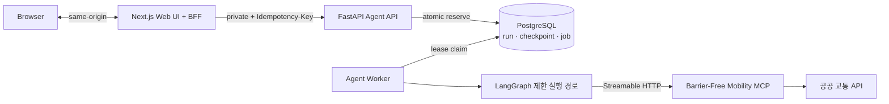
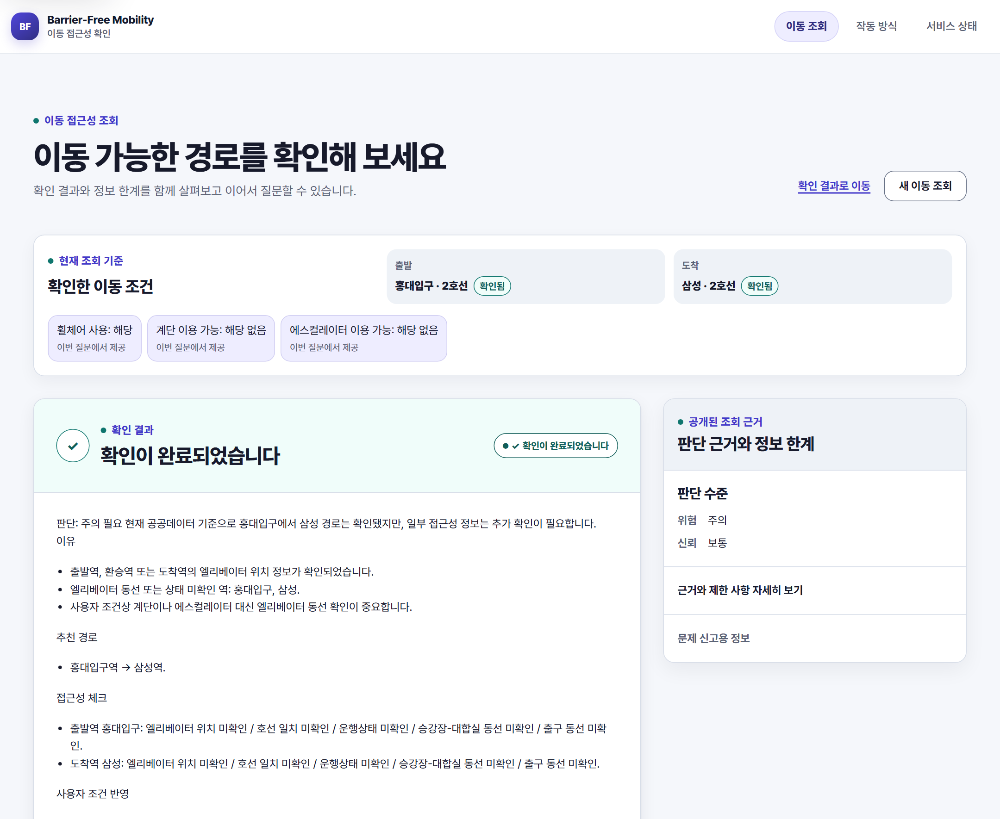

# Barrier-Free Mobility Agent

교통약자의 자연어 이동 질문을 이해하고 Barrier-Free Mobility MCP의 도구를 안전하게 조합하는 웹 기반 AI Agent 제품입니다.

> "휠체어를 사용하고 계단은 이용할 수 없어요. 홍대입구역에서 삼성역까지 갈 수 있어?"

교통약자에게 "경로가 존재한다"와 "그 경로를 실제로 이용할 수 있다"는 다른 문제입니다.
엘리베이터 한 대가 멈추면 경로 전체가 무효가 되고, 확인되지 않은 정보를 "가능하다"로 답하는
순간 사용자는 역에 고립됩니다. 이 저장소는 그 판단을 규칙 기반으로 계산하는
[Barrier-Free Mobility MCP](https://github.com/kaero313/barrier-free-mobility-mcp)를
실제 사용자 제품으로 구체화한 구현이며, 모델의 자율성보다 **재현 가능한 실행 경계와 불확실성
보존**을 우선합니다.

## 핵심 설계 결정

### 1. 판단은 MCP, 오케스트레이션은 Agent

이동 위험도와 시설 판정 규칙을 Agent에 복제하지 않습니다. Agent는 대화 문맥 유지, Tool 조합,
실패 복구, 응답 정책만 소유합니다. 두 저장소는 Python import가 아니라 Streamable HTTP 계약과
contract test로만 연결되므로, 도메인 규칙 변경은 MCP 배포로 끝나고 Agent 릴리스 주기와 분리됩니다.

### 2. 자율 ReAct 루프 대신 제한된 LangGraph 경로

모델은 Tool 이름을 보지도, 고르지도 않습니다. 모호한 질문에서만 `intent`와 `confidence`를
채우고 실제 Tool 집합은 versioned `ToolPolicy`가 결정합니다. Tool·모델 호출 수, graph step,
병렬성, 토큰, 시간은 요청별 예산으로 코드에서 강제합니다. 유연성을 포기한 대가로 **같은 질문이
같은 Tool 집합과 단계 수로 실행되는 재현성**, 예측 가능한 비용과 감사 가능성을 얻습니다.
현재 모든 playbook은 model 호출 0회의 deterministic 경로입니다.

### 3. 불확실성을 성공으로 재작성하지 않는다

MCP의 `PARTIAL`, `risk_level=UNKNOWN`, `failed_sources`, `limitations`를 정상 응답처럼
표현하지 않습니다. 계단·에스컬레이터 이용 가능 여부는 `true | false | unknown` 3-state로
관리하고, `unknown`을 라이브러리 기본값으로 채우는 대신 구조화된 clarification으로 되묻습니다.
안전 필수 조건이 끝내 `unknown`이면 외부 Tool을 호출하지 않고 "판단 불가"로 종료합니다.
보조 Tool의 빈 배열도 "시설 없음"으로 단정하지 않습니다.

### 4. 내구 실행과 fencing 경계

API와 worker를 분리하고, 실행 요청은 AES-256-GCM으로 암호화한 durable job queue에 원자적으로
예약합니다. worker 교체 시 lease token과 generation을 CAS로 검증하며, **LangGraph checkpoint
write까지 lease row guard 안에서 직렬화**해 교체된 process의 늦은 write를 차단합니다.
`tool.started`만 남은 모호한 구간은 자동 replay하지 않고 recovery-required로 fail closed합니다.
그 결과 read-only MCP 호출은 at-least-once임을 명시하고 end-to-end exactly-once를 주장하지 않습니다.

### 5. 공개 경계를 UI가 아니라 스키마에서 닫는다

Browser는 Agent port를 직접 호출하지 않고 same-origin BFF만 사용합니다. 내부 source 이름,
Tool, budget, 실패 reason은 화면에서 숨기는 것이 아니라 응답 스키마와 OpenAPI 자체에서
제외하고, 안정적인 공개 코드로 projection합니다. run/event ledger에는 질문, 역명, 이동 조건,
Tool 인자와 예외 문자열을 저장하지 않습니다.

## 아키텍처

위 경로로 생성한 실제 응답입니다. 확인된 이동 조건과 그 출처, `주의` 판단 수준, 아직 확인되지
않은 항목과 데이터 조회 시각을 같은 화면에서 보여줍니다. "이용 가능"이라는 단정 대신 무엇이
확인되었고 무엇이 확인되지 않았는지를 남기는 것이 이 제품의 응답 정책입니다.

## 책임 경계

| 웹 기반 Agent 제품 | Barrier-Free Mobility MCP |
|---|---|
| Assistant UI, same-origin BFF와 운영 Console | 독립 MCP 서버와 Tool 계약 |
| 대화 문맥과 사용자 이동 조건 유지 | 역·장소 정규화 |
| 의도 분류와 명확화 | 공공 API 연동과 캐시 |
| 허용된 Tool playbook 선택 | 경로·시설 데이터 정규화 |
| 복합 질의의 순서·병렬 실행 | 결정론적 위험 점수와 신뢰도 계산 |
| 재시도·중단·복구·스트리밍 | 부분 실패와 근거가 포함된 구조화 결과 |
| 응답 정책, 감사 로그와 관측 | 최종 사용자용 canonical `user_message` |

## 기술 스택

| 계층 | 기술 |
|---|---|
| Agent runtime | Python 3.13, LangGraph, LangChain, `langchain-mcp-adapters` |
| API | FastAPI, Pydantic v2, Uvicorn, uv |
| Web | TypeScript strict, Next.js App Router, same-origin BFF |
| 상태 저장 | PostgreSQL — `AsyncPostgresSaver`, owner-aware repository, 암호화 job queue |
| 품질 | pytest, Ruff, mypy strict, Vitest, Playwright, Docker Compose |

## 검증 방식

- **실제 PostgreSQL 카오스 테스트** — 복수 worker의 claim 경쟁, lease 교체 뒤 stale delayed
  write, checkpoint write와 reclaim의 row-lock 직렬화, 별도 subprocess를 hard-kill한 뒤
  generation 2로 재개하는 경로를 in-memory fake가 아닌 실제 DB에서 검증합니다.
- **실제 MCP 서버 대상 contract test** — MCP를 모듈로 import하지 않고, mock mode 서버와
  Agent Uvicorn을 별도 프로세스로 띄워 HTTP 계약을 검증합니다. CI는 검증된 MCP commit SHA를
  pin하고, upgrade PR에서 contract가 통과해야 갱신합니다.
- **계약 자동 동기화** — FastAPI OpenAPI 스냅샷에서 TypeScript 타입을 생성하고, 백엔드와
  프론트엔드 계약이 어긋나면 CI가 실패합니다.
- **접근성 회귀** — keyboard 이동, 한국어 IME, 320px reflow, 400% 확대, forced-colors,
  reduced-motion과 axe 검사를 Playwright E2E에 포함합니다.
- **품질 게이트** — Ruff, mypy strict, 커버리지 하한 85%, 컨테이너 이미지 빌드를 5개 CI job으로
  분리해 실행합니다.

## 현재 구현

MCP contract 수직 기능, bounded trip/facility workflow, 통합 Web vertical slice, durable
conversation, 구조화 clarification(response schema v4), durable run ledger, 암호화 durable
execution queue와 worker fencing까지 구현·검증했습니다. 단계별 상세 상태는
[구현 계획](docs/implementation-plan.md)에 기록합니다.

현재 경계는 다음과 같이 명시합니다.

- 모든 playbook은 **model 호출 0회**입니다. hosted model은 offline 평가 기반과 첫 후보 adapter까지
  구현했지만 후보 비교·선정 전이므로 운영 graph에 연결하지 않았고, token 절감 성과도 주장하지 않습니다.
- CI가 고정한 MCP SHA는 trip-only이므로 일반 배포 범위는 이동 조회이며, 시설 workflow는 MCP
  capability gate를 통과한 환경에서만 활성화됩니다.
- 일반 운영 토폴로지는 Agent API 1개·Worker 1개입니다. 다중 replica는 correctness gate를 통과했지만
  정식 release profile과 수동 검토 전에는 기본값을 변경하지 않습니다.
- 현재 anonymous session은 객체 격리 수단이며 end-user 인증이 아닙니다. delegated OIDC 이전에는
  hosted UI로 취급하지 않습니다.

## 실행

MCP 서버를 먼저 실행한 뒤 PostgreSQL을 포함한 전체 제품을 한 번에 기동합니다.

~~~powershell
docker compose up --build      # http://127.0.0.1:3000/assistant
~~~

native 실행, 다중 턴 clarification 예시, secret 설정과 검증 명령은
[실행과 검증 가이드](docs/getting-started.md)에 있습니다.

## 범위에서 제외하는 것

- Agent 내부에서 별도의 이동 위험 점수나 시설 판정 규칙을 만들지 않습니다.
- 공공 API를 Agent가 직접 호출하지 않습니다.
- 원본 Tool 응답 전체를 대화 메시지나 장기 기억에 계속 누적하지 않습니다.
- 모델의 내부 추론 과정은 API나 trace에 노출하지 않습니다.
- 운영 경로에서 무제한 자율 Tool 호출을 허용하지 않습니다.
- 내부 run ledger를 public event route, SSE 또는 `/ops`로 직접 노출하지 않습니다.

## 문서

- [아키텍처](docs/architecture.md) — 시스템 구성, LangGraph 흐름, 상태·토큰 전략, 장애 대응
- [구현 계획](docs/implementation-plan.md) — 단계별 산출물과 완료 조건
- [제품 UI/UX 설계](docs/product-design.md) · [정보 구조](docs/information-architecture.md) · [사용자 흐름](docs/user-flows.md)
- [운영 runbook](docs/runbooks/) — durable run ledger, execution worker
- [ADR](docs/adr/) — 11건의 결정 기록. 특히
  [제어된 Tool orchestration](docs/adr/0002-controlled-mcp-orchestration.md),
  [crash window 의미론](docs/adr/0010-durable-run-ledger-and-crash-semantics.md),
  [단계형 durable execution](docs/adr/0011-staged-durable-execution-coordination.md)
