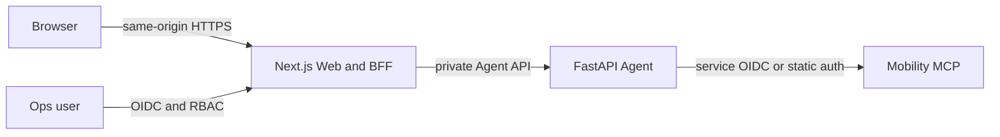

# ADR-0003: 동일 저장소 Next.js Web과 same-origin BFF 경계

- 상태: Accepted
- 날짜: 2026-07-10
- 범위: 사용자용 Assistant와 운영자용 Agent Console

## Context

Barrier-Free Mobility Agent는 browser UI, same-origin BFF, FastAPI/LangGraph runtime, 대화 문맥과 운영 surface를 함께 제공하는 하나의 웹 기반 Agent 제품이다. Python runtime은 MCP 인증, state, Tool policy와 이동 도메인 응답을 소유하고, browser UI는 대화, clarification, 결과와 운영 read model을 표현한다. Barrier-Free Mobility MCP만 이 저장소 밖의 독립 프로젝트로 유지한다.

초기 Agent API에는 browser CORS allowlist, 사용자 인증·thread ownership과 cookie session이 없었다. Phase 3B에서 local/demo anonymous session과 resource ownership은 추가했지만, MCP OIDC client credentials는 여전히 Agent가 MCP에 접근하기 위한 service credential이며 사용자 인증이 아니다. 또한 운영자 화면은 public DTO보다 더 민감한 진단 정보를 요구한다.

프론트엔드가 자연어를 파싱하거나 Agent 내부 state를 복제하면 안전 판단과 계약이 두 군데로 나뉜다. Web은 presentation과 interaction을 소유하되 intent, mobility semantics, retry와 Tool routing은 Agent가 소유해야 한다.

## Decision

### Repository와 runtime

- 이 저장소를 제품 경계로 삼고 Next.js source는 root의 `web/` 계층에 둔다.
- `web/`은 TypeScript strict mode와 Next.js App Router를 사용한다.
- public `/`, `/assistant`, `/how-it-works`, `/status`, `/accessibility`와 보호된 `/ops`는
  `web/` 안에서 shell, DTO와 권한 경계를 분리한다.
- Python source는 `src/barrier_free_mobility_agent/`에 유지하고 `web/`은 OpenAPI에서 생성한 client로만 공개 API를 호출한다.
- Web과 Python runtime은 build·process 경계를 가질 수 있지만 한 저장소, 한 제품 release와 통합 E2E gate로 관리한다. 별도 Web 제품이나 호환성 책임을 다른 저장소로 넘기지 않는다.
- Python과 Web dependency는 각각의 lockfile로 고정하고 같은 upgrade PR에서 필요한 contract test를 통과시킨다.

Next.js App Router는 layout, loading/error boundary, Server·Client Component와 streaming UI 경계를 제공한다. [Next.js App Router](https://nextjs.org/docs/app)

### Network boundary



- Browser는 Agent 포트를 직접 호출하지 않는다.
- Next.js Route Handler/BFF가 Agent API를 same-origin으로 proxy한다.
- BFF는 request ID, 사용자 session과 향후 authorization context를 전달한다.
- MCP credential은 Agent 밖으로 전달하지 않는다.
- BFF는 Agent `user_message`를 파싱하거나 도메인 상태를 재계산하지 않는다.
- Agent 오류 envelope와 status code는 의미를 바꾸지 않고 Web 공개 계약으로 projection한다.

### Hosted authorization boundary

same-origin BFF만으로 thread/run 소유권이 보장되지는 않는다. Phase 3B local/demo 경로는 HttpOnly HMAC anonymous session에서 opaque owner를 파생하고, PostgreSQL thread/run mapping과 owner-scoped checkpoint key를 저장한다. BFF는 별도 shared-token과 owner header를 내부 Agent에 전달하며 Agent는 start, get, resume, delete마다 owner를 검사한다. 다른 owner의 객체는 일반 404와 동일하게 숨긴다.

이 경계는 익명 browser session 사이의 객체 격리이지 사용자 신원 인증은 아니다. 따라서 delegated identity가 없는 상태로 local 개발 밖의 public Web을 연결하지 않는다.

hosted 전환 전에 다음 계약을 완성한다. 4~10의 local 기반선은 구현되었고 1~3의 OIDC subject를 동일 owner repository에 연결하는 작업이 남아 있다.

1. Web은 OIDC authorization code flow로 사용자 session을 만든다.
2. BFF는 Agent audience의 짧은 수명 delegated access token을 전달한다.
3. Agent는 token issuer, audience, signature, expiry와 subject를 직접 검증한다.
4. thread 생성 시 opaque owner subject를 저장한다.
5. start, get, resume와 delete마다 thread/run owner를 검사한다.
6. 존재하지만 소유하지 않은 resource도 정보 노출을 막기 위해 동일한 404 정책을 사용한다.
7. state, event와 artifact namespace에 owner boundary를 전파한다.
8. cookie 기반 mutation은 same-site policy와 CSRF 방어를 적용한다.
9. conversation, run과 오류 응답에는 `Cache-Control: no-store`를 적용한다.
10. Web·BFF·Agent access log에 질문 body, clarification 답변과 이동 조건을 기록하지 않는다.

BFF service identity나 private network만으로 end-user authorization을 대체하지 않는다. Agent가 delegated token을 받을 수 없는 배포에서는 mTLS BFF identity와 서명된 short-lived user assertion을 함께 검증하고 owner repository를 동일하게 적용한다.

### Contract boundary

- Agent OpenAPI에서 TypeScript client와 type을 생성한다.
- generated source를 수동 편집하지 않는다.
- CI가 사용한 OpenAPI artifact hash와 Agent schema version을 기록한다.
- Web contract test는 `run_status`와 `status`의 가능한 조합, clarification과 error envelope를 fixture로 검증한다.
- breaking change는 Agent schema version과 Web upgrade PR로 관리한다.
- raw MCP DTO와 `AgentState`는 Web contract에 포함하지 않는다.
- answer/run response schema 3의 intent-scoped `ConversationContextView`, singular `ClarificationView`와 trip/facility `AnswerPresentation` union만 presentation source로 사용한다.
- 시설 진입점은 BFF가 확인한 `readiness.status=ready`, `mobility_mcp.status=ready`, `facility_question` capability를 모두 만족할 때만 렌더링한다. capability 부재·readiness 실패를 browser 추정이나 feature copy로 덮어쓰지 않는다. readiness가 나빠져도 이미 받은 facility presentation은 숨기지 않는다.
- Web resume은 wire에서 optional인 `clarification_id`를 필수로 보내고 `STALE_CLARIFICATION`에서 draft를 보존한 채 최신 run을 다시 읽는다.
- deprecated `questions[]`와 `clarification_options[]`는 새 Web에서 사용하지 않는다.

### Application state

Web이 보유할 수 있는 상태는 다음으로 제한한다.

- 현재 `thread_id`, `run_id`
- 정리 대기 중인 이전 `thread_id`와 만료 시각을 담은 server-side session metadata
- 사용자가 작성 중인 draft
- 이미 공개 API로 받은 presentation transcript
- UI preference: 글자 크기, contrast, reduced motion override

origin, destination, mobility flag, facility target/type, risk와 Tool 상태의 authoritative value는 Agent가 소유한다. Web은 schema 3 context/presentation을 사용하고 질문 text에서 해당 값을 추출하지 않는다.

장기적으로 대화 복원은 browser local storage가 아니라 사용자 권한이 적용된 thread API를 사용한다. 이동 조건 원문을 local storage에 기본 보존하지 않는다.

### 요청 수명과 불확실한 실행 결과

start와 resume은 실행을 시작하거나 진행시키는 mutation이므로 Browser와 BFF는 timeout, 연결 종료와 5xx에서 자동 재전송하지 않는다. Agent 실행 deadline이 계약으로 공개되면 BFF upstream timeout은 그 deadline과 응답 전송 여유보다 짧게 두지 않는다. Browser 연결 종료도 Agent 실행 취소를 증명하지 않는다.

- Agent가 명시적인 non-422 HTTP 오류를 반환한 resume은 `GET /v1/runs/{run_id}` 한 번으로 terminal 상태를 조정한다.
- transport disconnect 뒤 조회한 `completed`와 `failed`만 확정 결과로 신뢰한다.
- 같은 조회의 `interrupted`는 resume 전 checkpoint일 수 있으므로 재개 가능 상태로 해석하지 않는다.
- transport 결과가 불명확하면 해당 run의 추가 resume을 잠그고, draft를 보존한 새 thread를 기본 복구로 제공한다.
- `새 이동 조회`는 새 thread 생성과 active ID 전환을 먼저 완료한 뒤 이전 thread를 best-effort 삭제한다.
- 현재 단계에서 삭제 실패 ID의 재시도는 같은 tab 수명 안에서만 best-effort로 수행하며 browser unload event를 정리 보장 수단으로 사용하지 않는다.
- BFF server session에 실패 ID를 보존하고 TTL cleanup으로 재처리하는 기능은 Phase 4+ 후속 계약이다.

Phase 2C API는 accepted run ID 사전 할당, idempotency key, 실행 중 상태의 version/interrupt ID와 event stream이 없어 transport ambiguity를 안전하게 해소할 수 없다. 후속 계약에서는 이 항목들을 추가해 동일 mutation의 결과 조회와 안전한 재시도를 가능하게 한다. 그 전까지 새 thread 복구는 의도적으로 보수적인 정책이다.

### UI architecture

```text
web/
├─ src/
│  ├─ app/
│  │  ├─ page.tsx              # product entry
│  │  ├─ assistant/
│  │  ├─ how-it-works/
│  │  ├─ status/
│  │  ├─ accessibility/
│  │  ├─ ops/                  # protected shell
│  │  ├─ api/agent/             # same-origin BFF
│  │  ├─ error.tsx
│  │  └─ layout.tsx
│  ├─ features/
│  │  ├─ conversation/
│  │  ├─ clarification/
│  │  ├─ result/
│  │  └─ ops-runs/
│  ├─ components/               # semantic design primitives
│  ├─ lib/agent-api/            # generated client and thin adapter
│  └─ styles/                   # CSS variables generated from tokens
└─ test-fixtures/               # public DTO only
```

- native HTML semantics를 우선하고 headless component는 필요한 interaction에만 사용한다.
- `docs/design-tokens.json`을 CSS custom properties로 변환한다.
- Storybook에서 API 상태 조합과 forced-colors/reduced-motion state를 검증한다.
- component/unit test와 별도로 Playwright + axe를 사용한 keyboard·accessibility E2E를 둔다.
- textarea Enter는 줄바꿈이며 명시적 submit button을 기본으로 한다. shortcut을 추가하면 IME composition을 검사한다.

### 사용자와 운영 API 분리

- 사용자 BFF는 public `/v1` 계약만 호출한다.
- public status handler는 raw readiness를 allowlist `PublicServiceStatus`로 mapping하고 internal
  ops DTO를 사용하지 않는다.
- 운영 BFF는 향후 `/internal/ops/v1` read model만 호출한다.
- 운영 DTO는 public DTO를 확장하지 않고 별도로 versioning한다.
- `/ops`는 `ops.viewer`, `ops.diagnostics` 같은 RBAC scope를 확인한다.
- 운영 화면에서 thread ID는 hash로 표시하고 질문·정확한 위치·이동 조건은 기본 masking한다.
- chain-of-thought, 전체 prompt와 raw Tool payload는 권한과 관계없이 제공하지 않는다.

## Alternatives

### 별도 Web repository

Node와 Python의 dependency 경계를 물리적으로 분리할 수 있지만 OpenAPI 변경, 디자인 계약, UI와 Agent E2E가 서로 다른 release에 흩어진다. Web UI와 문맥·운영 API는 하나의 Agent 제품을 이루므로 선택하지 않았다.

### Browser에서 FastAPI 직접 호출

CORS, 사용자 인증, cookie/CSRF, thread ownership과 운영 API 격리를 Agent public edge에 모두 추가해야 한다. 현재 계약과 맞지 않고 MCP service credential과 사용자 session 경계도 흐려져 선택하지 않았다.

### 정적 SPA만 배포

간단하지만 same-origin BFF, OIDC session, 운영 RBAC와 server-side error boundary를 별도로 만들어야 한다. 사용자·운영 surface를 한 Web boundary에서 관리하기 위해 선택하지 않았다.

## Consequences

### Positive

- 한 저장소에서 Web, BFF, Agent API와 운영 계약을 함께 변경하고 검증한다.
- Python Agent와 Web의 runtime·보안 경계는 유지한다.
- MCP credential과 private Agent endpoint를 browser에서 숨긴다.
- OpenAPI 기반 계약 drift를 CI에서 검출할 수 있다.
- 사용자 UI와 운영 Console이 디자인 시스템을 공유하면서 DTO·권한은 분리된다.
- frontend가 이동 도메인 판단을 복제하지 않는다.

### Cost

- 한 저장소에서 Node와 Python toolchain, lockfile과 build cache를 함께 관리해야 한다.
- local development에서 같은 제품의 Web·Agent runtime과 별도 MCP 프로젝트를 함께 실행해야 한다.
- OpenAPI 생성물과 schema version을 동일 PR에서 동기화해야 한다.
- full-stack E2E 환경을 별도로 구성해야 한다.

## Implementation order

1. 완료: Agent-owned `ClarificationView`, `ConversationContextView`, discriminated `AnswerPresentation` schema 3
2. 완료: 첫 Web release를 trip-only로 고정하고 facility를 readiness capability 뒤에 배치
3. 완료: 동일 저장소 `web/` scaffold와 design token pipeline
4. 완료: BFF contract client와 trip Assistant vertical slice
5. 완료: public projection hardening
6. 상태 적응형 Assistant
7. product entry, 작동 방식, 공개 상태와 접근성 route
8. thread persistence·event ledger에 맞춘 refresh와 실제 event UI
9. `/internal/ops/v1` read model과 인증된 Agent Console

통합 Assistant를 먼저 그린 뒤 frontend에서 현재 API의 빈 부분을 추정으로 채우는 구현은 하지 않는다.

제품 route, public status와 protected ops의 장기 경계는
[ADR-0008](0008-product-trust-and-operations-surfaces.md)을 따른다.
