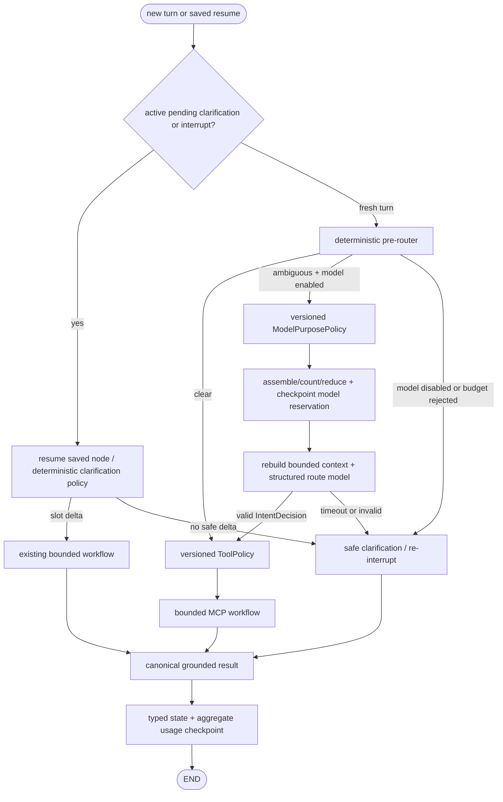

# ADR-0006: 구조화 문맥 projection과 token budget

- 상태: Accepted
- 날짜: 2026-07-12
- 범위: thread state 크기, future structured-model 입력, token accounting과 context reduction

## Context

현재 Agent는 일반 chat transcript를 저장하지 않는다. `AgentState`에는 최신
`current_input`, trip·mobility·facility slot, active clarification, 공개 outcome과 실행
ledger만 JSON 값으로 저장한다. 새 turn은 입력·결과·turn ledger를 덮어쓰고 확인된 slot만
이어 간다. 또한 현재 `ToolPolicy`가 만드는 모든 playbook의 `max_model_calls`는 0이며 실제
model provider, prompt와 token usage adapter도 없다.

따라서 지금 `MessagesState`, 최근 6개 원문 turn과 LLM conversation summary를 추가하면 줄일
model context보다 새로 저장하는 민감한 위치·이동 조건이 더 많아진다. 모델을 호출하지 않는
경로에서 summary model을 실행하는 것도 비용 절약이 아니라 비용 추가다. 반대로 model을 나중에
붙인 뒤 provider usage만 기록하면 호출 전에 context window 초과를 막을 수 없다.

다음 세 예산은 의미와 실패 정책이 다르므로 하나의 "token budget"으로 섞지 않는다.

1. graph·Tool·model 호출 수와 clarification 횟수 같은 실행 예산
2. checkpoint에 직렬화되는 최신 state와 누적 checkpoint history의 저장 예산
3. 특정 model 호출에 실제로 전달되는 prompt input/output token 예산

LangGraph checkpointer는 thread state를, Store는 cross-thread application memory를 담당한다.
이번 결정은 thread state와 model 호출 경계만 다루며 opt-in 장기 기억 Store는 포함하지 않는다.

## Decision

### 1. typed state를 유일한 authoritative 문맥으로 유지한다

- `trip_context`, `mobility_context`, `facility_context`가 이동 문맥의 source of truth다.
- route/MCP business clarification은 `pending_clarification`, station selection은 suspended nested
  subgraph task와 LangGraph interrupt payload가 source of truth다. 둘을 하나의 top-level field로
  복제하지 않는다.
- 별도 `conversation_summary`에 같은 사실을 문장으로 복제하지 않는다. summary와 slot이
  충돌할 때 어느 값을 믿을지 결정해야 하는 구조 자체를 만들지 않는다.
- 원본 MCP result, provider response, prompt 문자열, 전체 message history는 checkpoint에 넣지
  않는다.
- 기존 `current_input`을 조용히 자르지 않는다. 필수 context만으로 model hard limit을 넘으면
  model을 호출하지 않고 명확화 또는 `AgentBudgetExceededError`로 종료한다.
- cross-thread preference는 향후 `AsyncPostgresStore`에 명시적 동의 항목만 저장하며 이
  context projection이 Store를 읽거나 쓰지 않는다.

현재 typed slot이 사실상 구조화 digest이므로 `ConversationDigest`라는 두 번째 영속 모델은
추가하지 않는다. model이 필요할 때만 다음 ephemeral projection을 만든다.

```text
ModelContextEnvelope
├─ schema_version, context_policy_version
├─ purpose, prompt_version, model_alias
├─ current_input                         # critical, 원문 보존
├─ active_clarification projection       # critical; top-level 또는 saved task/interrupt
├─ confirmed_mobility_slots + provenance # critical
├─ active trip/facility target           # required for the purpose
├─ evidence_digest                       # bounded, optional/important
└─ assembly_report                       # count와 reason code만, 값은 없음
```

`ModelContextEnvelope`는 prompt formatter의 입력일 뿐 graph state나 run payload로 저장하지
않는다. 저장하는 것은 아래의 aggregate usage와 reduction reason code뿐이다.

### 2. context reduction은 model 호출 직전의 결정론적 projection이다

전역 `summarize` graph node를 두지 않는다. model reservation과 invocation 경계에서
`ModelContextAssembler`가 purpose별 allowlist와 우선순위로 envelope를 만들고 prompt는 호출
직전에만 포맷한다. 같은 state, policy version과 token counter는 같은 envelope와 reason code를
만들어야 한다.

우선순위는 다음과 같다.

| 우선순위 | 항목 | 정책 |
|---|---|---|
| critical | 최신 사용자 입력, active clarification ID·prompt·field, 사용자가 명시·확인한 mobility value와 provenance | 삭제·요약·부분 문자열 truncate 금지 |
| required | 현재 목적에 필요한 trip origin/destination 또는 facility target/type, 안전 policy version | 목적별 전체 항목 단위로 보존 |
| important | 최근 terminal status, risk/confidence, checked time, failed/unverified category의 bounded digest | 중복 label과 설명부터 제거 |
| optional | 이전 결과 설명, UI용 중복 label, 향후 평가로 허용된 bounded turn digest | soft limit부터 오래된 항목 순서로 제외 |

reduction 순서는 `derived/duplicate 제거 → optional 제거 → important의 bounded digest 사용`이다.
critical/required만으로 hard limit을 넘으면 reduction 성공으로 위장하지 않는다. model을 호출하지
않고 안전하게 실패한다. station·mobility slot, MCP status/risk와 active clarification을 LLM
summary가 새로 만들거나 변경할 수 없다.

향후 자유 형식 follow-up 평가에서 typed slot만으로 부족하다는 근거가 생기면 최대 6개의
`TurnDigest`를 optional category로 추가할 수 있다. 이때도 원문 transcript를 기본 저장하지
않고 structured output을 검증하며, digest model 실패 시 candidate를 commit하지 않고 기존
optional TurnDigest를 유지한다.
이 확장은 별도 평가 gate 없이는 활성화하지 않는다.

### 3. model boundary를 먼저 만든 뒤 token 절감을 측정한다

provider-neutral port는 다음 의미를 제공한다.

```text
ModelInvocation[T]
├─ canonical messages and system policy
├─ response schema / structured-output mode
├─ model profile, immutable provider-contract version and provider request options
├─ max_output_tokens
└─ purpose, prompt/context-policy version

StructuredModel[T]
├─ await count_input(invocation: ModelInvocation[T]) -> TokenCount
└─ await invoke_structured(invocation: ModelInvocation[T], preflight: TokenCount)
   -> ModelInvocationResult[T]

ModelResult[T]
├─ value: validated T
├─ usage: ModelUsage
├─ provider_alias, model_alias, provider_contract_version
└─ prompt_version

ModelFailure
├─ kind: timeout | transport | invalid_structured_output | provider_error
├─ usage: ModelUsage | None
└─ safe_error_code                    # raw output/exception은 없음

ModelInvocationResult[T] = ModelResult[T] | ModelFailure

ModelUsage
├─ input_tokens, output_tokens, total_tokens
├─ cached_input_tokens?, reasoning_output_tokens?
├─ source: reported | mixed | estimated
└─ estimator_version?
```

- count와 invoke는 같은 immutable `ModelInvocation`과 그 count 결과를 사용한다. response JSON schema, system
  wrapper, tool schema가 있다면 그것과 provider가 실제 wire request에 추가하는 token-bearing
  option까지 counter 계약에 포함한다.
- graph에는 provider SDK object나 `AIMessage`를 저장하지 않는다.
- adapter는 provider usage를 structured value validation과 분리해 먼저 정규화한다. invalid value와
  함께 유효한 usage를 받았으면 raw output을 버리고 `ModelFailure(usage=...)`로 전달한다.
- 사전 admission은 응답 뒤에 오는 provider usage가 아니라 token counter로 계산한다.
- adapter가 지원하는 exact/local counter를 우선하고, 없으면 versioned conservative estimator를
  사용한다.
- 한국어에서 단순 `4 chars = 1 token` 추정은 hard gate로 사용하지 않는다. provider/model이
  정해지기 전 `fallback-v1`은
  `ceil(canonical UTF-8 bytes × 1.25) + 32 × logical message/schema block 수`를 사용한다.
  이는 비용 예측이 아니라 undercount를 피하기 위한 admission upper bound다.
- 사후 accounting은 표준 `usage_metadata`를 우선한다. 누락·모순 필드만 같은 호출의
  preflight estimate로 보완하고 `mixed`로 기록한다.
- usage 값은 non-negative integer여야 하고 `total >= input + output`이어야 한다. total-only
  응답은 provider total과 estimated input/output 합 중 큰 값을 charge한다. 모순되는 provider
  field는 그대로 신뢰하지 않는다.
- cache read token은 비용 detail로 따로 기록하되 context window input에서 빼지 않는다.
- 절감량은 동일한 estimator version으로 reduction 전후를 계산한다. 서로 다른 tokenizer의
  수치를 비교해 savings로 표시하지 않는다.

정산은 다음 결정식을 사용한다. `Eᵢ/Eₒ`는 같은 invocation의 conservative input/output
estimate, `Pᵢ/Pₒ/Pₜ`는 검증을 통과한 provider field다.

```text
charged_input  = Pᵢ가 유효하면 Pᵢ, 아니면 Eᵢ
charged_output = Pₒ가 유효하면 Pₒ, 아니면 Eₒ
charged_total  = max(유효한 Pₜ 또는 0, charged_input + charged_output)
```

total-only report도 위 식을 사용한다. timeout·transport unknown·invalid structured output처럼
provider가 token을 소비했을 가능성이 있지만 trustworthy usage를 받지 못하면
`Eᵢ + reserved_output` 전체를 charge한다. invalid output과 함께 유효한 usage가 있으면 위
정규화 수치만 charge한다. 하나라도 provider field를 사용하면 `mixed`, 모두 estimate면
`estimated`, 완전하고 일관된 input/output/total을 사용하면 `reported`다.

### 4. budget profile과 기본값

model이 활성화될 때 provider/model profile에 context window를 명시한다. model 이름에서 window를
추측하지 않는다.

```text
state serialized hard limit          65,536 bytes
application model input cap           4,096 tokens
soft reduction trigger                hard input의 70%
reduction target                      hard input의 50%
output reserve                         최소 512 tokens, provider hard max와 동일
context safety reserve                 최소 256 tokens
fallback estimator margin             25% + message당 고정 overhead
global model calls per turn           기존 설정 기본 2
ambiguous-routing calls per turn      purpose policy 최대 1
charged model tokens per run          기본 12,000
deterministic reduction decisions     model invocation당 최대 1
LLM digest compaction                 현재 0회, future 최대 1/run
optional recent turn digests          최대 6, 기본 비활성
```

호출별 usable hard input은 다음 값이다.

```text
min(
  application input cap,
  provider context window - output reserve - context safety reserve
)
```

호출 전에는 `estimated_input + output_reserve`를 run 잔여 예산에 예약한다. 호출 뒤 provider
usage가 더 크면 실제 수치를 charge하고 budget violation을 기록하며 같은 run의 다음 model
호출을 막는다. 이미 검증된 안전한 응답을 token 초과만으로 폐기하지는 않는다.

`ModelInvocation.max_output_tokens`는 reservation보다 작거나 같아야 하며 adapter가 provider의
실제 hard output parameter로 전달한다. reasoning token이 output cap에 포함되는지 model profile에
명시하고, 전체 generated token을 hard cap으로 제한할 수 없는 adapter는 활성화하지 않는다.
`context_window <= output_reserve + safety_reserve`이거나 필수 profile 값이 없으면 startup에서
실패한다.

generic `fallback-v1`은 local/test와 adapter 평가에만 사용한다. hosted model 활성화는 exact
counter 또는 provider가 보장하는 conservative counter가 필요하며, 선택 model의 한국어·영어
혼합, emoji, JSON schema와 provider option golden corpus에서 wire request 대비 undercount 0을
release gate로 강제한다. 이 gate를 통과하지 못하면 model은 optional이어도 hosted에서 비활성화한다.

65,536-byte state limit은 token limit이 아니다. application hard gate는 각 node update를 기존
값과 merge한 top-level 또는 nested-subgraph `AgentState`를 key sort, compact separator와 UTF-8로
canonical JSON serialization한 byte length에 각각 적용한다. `interrupt()` payload는 호출 전에
별도 동일 limit을 적용한다. framework checkpoint metadata, pending-write wrapper, serializer
encryption overhead와 과거 snapshot은 이 hard gate에서 제외하고 실제 saver byte metric과
retention으로 따로 관측한다. MCP/public DTO의 문자열과 배열에 명시적 상한을 두고, 외부 결과가
state로 들어오는 node에서 compact DTO로 projection한 뒤 merge된 크기를 검증한다. limit 초과
결과를 checkpoint한 다음 줄이는 방식은 허용하지 않는다.

LangGraph는 `start`와 business clarification의 invocation input을 첫 node보다 먼저 checkpoint한다.
따라서 runner는 모든 state-input `ainvoke` 전에 최신 snapshot과 input update를 LangGraph와 같은
overwrite semantics로 merge해 동일 byte preflight를 실행한다. 초과하면 `ainvoke` 자체를 호출하지
않아 `source=input` oversized checkpoint를 만들지 않는다. `Command(resume=...)` 입력은 request와
interrupt payload 상한을 통과한 뒤 saved node로 전달한다.

### 5. LangGraph 통합 순서

현재 deterministic route와 fixed Tool playbook을 그대로 기본 경로로 유지한다.



- 명확한 질문은 계속 model 0회다.
- saved interrupt 또는 `pending_clarification`이 있으면 해당 resume 정책이 항상 model fallback보다
  우선한다. deterministic slot delta가 없으면 기존 clarification을 다시 제시하며 model로 의미를
  추측하지 않는다. fresh non-pending turn만 ambiguous model admission 대상이다.
- model fallback은 `IntentDecision`만 반환하며 Tool 이름과 순서를 선택하지 않는다.
- `reserve_model`은 아직 `ExecutionPlan`이 없는 위치이므로 ToolPolicy와 별도의 versioned
  `ModelPurposePolicy`가 허용 purpose와 limit을 결정한다. 초기 allowlist는
  `ambiguous_routing` 하나이며 effective call limit은 global, purpose와 run 잔여 limit 중
  최솟값이다. `ExecutionPlan.max_model_calls`는 route 이후 playbook 내부 model만 허용하며,
  pre-route 호출 권한으로 재사용하지 않는다. 두 종류 모두 global/run aggregate에는 합산한다.
- assembler와 prompt formatter는 reservation/model node 내부의 ephemeral component다. 별도
  node output으로 prompt/envelope를 checkpoint하지 않는다.
- `reserve_model` node는 purpose, model/prompt/context-policy/counter version, estimated input,
  output reserve, logical call counter와 canonical invocation의 keyed fingerprint를
  `model_reservation`으로 checkpoint한다. hosted fingerprint key는 checkpoint key에서 domain
  separation해 파생하고 원문 hash를 log/metric에 내보내지 않는다. 다음 model node는 같은
  state에서 invocation을 다시 만들고 version·fingerprint·count가 reservation과 일치하는지 확인한
  뒤 호출한다. persistent backend에서 model을 활성화할 때 stable fingerprint key가 없으면
  startup에 실패하고 memory test는 명시적으로 fake key를 주입한다.
- SDK 자동 retry는 기본 0이다. logical reservation과 provider attempt를 정확히 연결하는 durable
  attempt ledger는 Phase 4 전까지 없으므로 process crash의 provider-accepted/response-uncommitted
  구간은 비용·결과 unknown과 orphan reservation으로 문서화한다. 자동 retry나 restart replay가
  횟수를 숨겨 budget을 우회하게 두지 않는다.
- `run_model_calls`, `run_input_tokens`, `run_output_tokens`, `run_total_tokens`,
  `context_reduction_count`는 clarification resume에도 누적한다. turn counter만 새 turn에서
  초기화한다.
- 현재 playbook의 `max_model_calls=0`은 structured model adapter와 동일 fixture 평가가 끝날 때까지
  유지한다. 그 전에는 token savings를 실제 운영 성과처럼 표시하지 않는다.

reservation은 state에 `open`인 동안만 model node가 소비할 수 있다. model node는 한 번의 state
update에서 reservation을 제거하고 다음 중 하나로 `RunUsage` revision을 정산한다.

| 전이 | provider 호출 | token charge | 다음 경로 |
|---|---:|---|---|
| `open → settled` | 성공·usage 정규화 | normalized actual/estimate | validated decision |
| `open → failed_settled` | invalid output/provider error와 trustworthy usage | normalized actual/estimate | clarification |
| `open → unknown_charged` | timeout·transport·invalid output이며 trustworthy usage 없음 | estimated input + full output reserve | clarification |
| `open → rejected` | version/fingerprint/count/profile mismatch로 호출 전 거부 | token 0, logical call은 소비 | fail-fast/clarification |

terminal state에 outstanding reservation을 남기지 않는다. 같은 live graph execution에서는 같은
version/fingerprint의 `open` reservation만 model node가 소비한다. 그러나 현재 public run ID와
metadata row는 graph가 반환된 뒤 생성되므로 reservation 뒤 process crash는 공개 resume 대상이
없는 orphan checkpoint를 만들 수 있다. Phase 4 전에는 이런 thread의 새 run을 거부하고
`MODEL_RESERVATION_RECOVERY_REQUIRED`로 새 thread 복구를 안내하며, TTL/관리 repair가 해당 thread를
전체 삭제한다. 자동 model 재호출이나 open reservation 강제 clear는 하지 않는다. run ID
선할당·lease·attempt ledger가 구현된 Phase 4에서만 open reservation의 restart continuation을
활성화한다. 따라서 `RunUsage`를 exact billing ledger라고 부르지 않는다.

### 6. persistence와 API

- `AgentState.run_usage`가 admission과 resume budget의 authority다. monotonic `revision`을 포함한
  optional aggregate로 저장해 interrupt/restart 뒤에도 budget을 이어 간다. 기존 checkpoint가
  필드를 갖지 않으면 fresh zero usage로 읽는다.
- `GraphTurn`과 내부 `ConversationRun`이 `RunUsage(schema_version="1")`를 전달한다.
- `agent_runs.usage`는 마지막 성공 repository transaction의 운영 read-model이며 exact billing
  ledger가 아니다. checkpoint와 metadata transaction 사이 crash에서 state보다 revision이 늦을
  수 있음을 허용하고 감지한다.
- repository schema 4 migration은 `usage JSONB NULL` 추가 → 기존 row를 schema 1 zero usage로
  backfill → JSON object check와 `NOT NULL` 적용 → DB default 제거 순서로 수행한다. 영구 zero
  default로 insert 누락을 숨기지 않는다. `add_run`과 `update_run`은 outcome/context/usage를 같은
  metadata transaction에서 명시적으로 기록한다.
- `RunUsage`는 extra field를 금지하고 non-negative token, `total >= input + output`, usage source
  (`none | reported | mixed | estimated`)와 reason allowlist, schema/revision을 검증한다. decode 전
  `usage.schema_version`을 먼저 확인하고
  호환되지 않으면 `AgentStateIncompatibleError`를 반환한다. 기존 outcome/context의
  `payload_schema_version` 의미는 바꾸지 않는다.
- aggregate `RunUsage.source`는 model 호출이 없으면 `none`, 모든 call이 `reported`면 `reported`,
  모든 call이 `estimated`면 `estimated`, `mixed` call이 하나라도 있거나 reported와 estimated가
  함께 있으면 `mixed`다. 한 번 `mixed`가 된 aggregate는 후속 call에서 되돌리지 않는다.
- resume 성공·실패 metadata를 쓸 때 stale `ConversationRun.usage`를 다시 저장하지 않는다. 최신
  graph state usage를 projection하거나, 읽지 못하면 기존 DB usage revision을 보존하고 stale
  상태를 운영 신호로 남긴다.
- repository는 run row를 잠그고 incoming usage revision이 더 높을 때만 교체한다. 낮은 revision은
  기존 값을 보존하고 stale-write 신호를 남기며, 같은 revision의 다른 payload는 idempotent
  update로 보지 않고 policy violation으로 거부한다.
- memory와 PostgreSQL repository가 같은 usage 계약을 구현한다.
- 공개 response schema v3에는 provider/model/token/cost를 추가하지 않는다. `/ops` read model이
  생길 때 redacted 내부 계약으로 제공한다.
- 현재 public `run_id`는 graph 실행 뒤 할당되므로 invocation별 durable event ledger는 만들지
  않는다. 호출 detail은 low-cardinality metric/trace로만 내보내고, run ID 선할당과 정확한 crash
  correlation은 Phase 4 durable execution에서 구현한다.
- exact repository migration verifier 때문에 schema 4 cutover는 현재 단일 replica에서
  `Agent stop → migrate → new binary start`로 수행한다. 이전 binary 즉시 rollback 대신
  forward-fix를 기본으로 하며 rolling expand/contract는 Phase 4 배포 계약에서 추가한다.

token context reduction과 누적 checkpoint history 정리는 서로 다른 문제다. active interrupt를
포함한 checkpoint를 임의 삭제하지 않는다. thread TTL, latest-N checkpoint pruning과 orphan
cleanup은 saver 호환성·복구 정책을 검증한 별도 retention 작업으로 둔다.

### 7. failure policy

| 실패 | 처리 |
|---|---|
| exact counter 미지원 | local/test는 conservative estimator, hosted model은 activation 거부 |
| counter/estimator 자체 실패 | model 호출 금지, deterministic clarification 또는 budget error |
| critical context가 hard limit 초과 | truncate 금지, model 호출 0회와 `context_required_overflow` |
| invalid structured output + trustworthy usage | `failed_settled`, normalized usage, 자동 retry 없이 clarification |
| timeout/transport/invalid output + usage 없음 | `unknown_charged`, full reservation charge와 clarification |
| provider usage 누락 | preflight/출력 estimate로 보완하고 `mixed` 또는 `estimated` |
| reported usage가 예약량 초과 | 실제 usage charge, violation metric, 같은 run의 후속 model 차단 |
| optional future TurnDigest 생성 실패 | candidate 미저장, authoritative slot과 기존 TurnDigest 유지 |
| state/usage/policy version 불일치 | silent 재해석 없이 fail-fast 또는 명시적 migration |
| reservation version/fingerprint mismatch | provider 호출 0회, `rejected` 정산과 fail-fast |

active clarification checkpoint를 background compactor가 재작성하지 않는다. context reduction은
`reserve_model`에서 model invocation projection에만 적용한다. completed/new-turn boundary는
기존 state reset과 byte validation만 수행한다.

state byte budget도 실행 중 state를 사후 삭제하는 compactor가 아니다. `tool_ledger`, turn/run
counter, resolution, `model_reservation`, pending interrupt와 nested subgraph task는 절대 제거하지
않는다. 외부 MCP/model 결과를 state update로 반환하기 전에 allowlisted DTO로 projection하고
limit을 검증한다.

### 8. observability와 privacy

다음 값만 metric/trace attribute로 기록한다.

- purpose, prompt/context-policy/model alias와 version
- allowlisted outcome, direction, stage와 deploy `flow_version`
- estimated/reported input·output·total token
- usage source, reduction 여부·reason code와 제거한 category 수
- soft/hard/run budget 사용률, rejection/violation 수
- state serialized byte size

owner ID, thread ID 원문, 역명, 질문, mobility value, clarification 답변, prompt와 MCP payload를 metric
label이나 일반 log에 넣지 않는다. `model_alias`, purpose, reason code는 allowlist로 제한해 cardinality를
고정한다.

Stage A에는 model을 public readiness dependency로 추가하지 않는다. model fallback이 optional이면
provider 장애 시 deterministic route/clarification이 계속 동작하고 overall readiness도 유지한다.
향후 model이 필수 경로가 될 때만 `required`가 포함된 versioned model readiness를 추가하며, 유료
generation probe 대신 startup config 검증과 passive 최근 호출 상태를 사용한다. provider 가격표가
versioned contract로 들어오기 전에는 token을 임의 비용으로 환산하지 않는다.

권장 metric은 다음과 같다.

```text
agent_model_calls_total{purpose,outcome,usage_source,model_alias}
agent_model_tokens_total{purpose,direction,usage_source,model_alias}
agent_context_reductions_total{purpose,reason}
agent_context_budget_rejections_total{purpose,reason}
agent_context_budget_violations_total{purpose,reason}
agent_context_input_tokens{purpose,stage}
agent_state_serialized_bytes{flow_version}
```

## Compatibility and rollout

1. **Stage A — 현재 경로 계측**: state 외부입력 상한, 65,536-byte invariant, zero `RunUsage`,
   counter/assembler unit contract를 구현한다. model 호출은 여전히 0이다.
2. **Stage B — structured model boundary**: 동일 한국어 fixture로 후보 model의 structured output,
   canonical wire request tokenizer undercount, output hard-cap mapping, latency와 비용을 평가한다.
   hosted gate를 통과한 adapter와 fresh ambiguous route fallback만 활성화한다.
3. **Stage C — reduction 검증**: over-budget synthetic envelope에서 priority reduction과 hard
   rejection을 검증하고 reduction 전후 동일 task 정확도를 비교한다.
4. **Stage D — optional turn digest**: offline eval에서 typed slot만으로 해결하지 못한 실제
   cross-turn 사례가 있을 때만 별도 ADR/contract로 추가한다.
5. **Stage E — long-term memory**: 인증 subject, 동의·조회·수정·철회·삭제가 준비된 뒤 Store를
   연결한다.

2026-07-13에는 Stage B의 provider-independent 부분인 strict model-only intent/context 계약,
canonical invocation assembler, open reservation과 네 terminal 정산 코어, synthetic 한국어
128-case normalized replay gate를 구현했다. 이어 immutable OpenAI Responses 첫 후보 contract,
count/invoke 공통 wire, retry 0 adapter와 보호형 live evaluator를 추가했다. 이 recorded baseline과
미실행 live gate는 hosted model 정확도나 비용을 증명하지 않는다. 두 번째 후보 비교·선택과 graph
연결 전까지 production playbook은 계속 model 0회다.

Stage A의 state field는 optional default로 추가한다. node 이름은 바꾸지 않는다. model fallback은
business behavior 변경이므로 새 `flow_version`으로 release하고 기존 interrupted thread를 drain하거나
명시적으로 종료한 뒤 전환한다. 새 code가 이전 checkpoint를 자동으로 재해석하지 않는다.

## Acceptance criteria

- 명확한 trip/facility fixture는 model과 context reduction을 모두 0회 사용한다.
- active top-level clarification과 nested station-selection interrupt resume은 model admission에
  진입하지 않으며 slot delta가 없으면 같은 clarification을 유지한다.
- ambiguous fixture만 허용된 structured model path로 가며 Tool allowlist는 model output과 무관하게
  `ToolPolicy`가 결정한다.
- `ModelPurposePolicy`가 허용하지 않은 purpose와 exhausted global/purpose/run budget은 reservation
  전에 provider 호출 0회로 거부된다.
- production admission counter는 local exact 또는 provider가 보장한 local conservative 구현이어야
  한다. 사용자 입력을 보내는 원격 count endpoint는 live 평가 truth로만 사용하며 runtime의
  "reservation 전 provider 호출 0회"를 대체하지 않는다.
- counter와 invoke가 동일한 `ModelInvocation`을 사용하고 system wrapper, structured-output schema,
  provider option을 포함한 golden wire request에서 hosted counter undercount가 0이다.
- profile의 context/output/safety 값이 누락·모순되거나 provider hard output cap이 reservation과
  연결되지 않으면 startup이 실패한다.
- 같은 envelope의 reduction 전후 token은 같은 counter/version으로 비교된다.
- soft limit에서는 optional/important 순서로만 줄고 critical/required 값은 deep-equal이다.
- 최신 질문, confirmed mobility provenance, active clarification ID·field와 MCP status/risk가
  truncate·재작성되지 않는다.
- required context가 hard limit을 넘으면 provider 호출이 0회다.
- provider usage의 정상, 일부 누락, total-only, 음수·모순 case를 각각 검증한다.
- invalid structured output과 trustworthy usage가 함께 온 case는 `failed_settled`로 실제 usage를
  보존하고 raw output은 저장·log하지 않는다.
- reported/estimated 호출이 여러 clarification에 섞여도 `RunUsage.source`가 monotonic fold 규칙을
  따르고 restart 뒤 동일하다.
- reservation의 `settled`, `failed_settled`, `unknown_charged`, `rejected` 전이마다 terminal
  outstanding reservation이 없고 charge/revision이 결정적이다.
- model node 진입 전 model/prompt/context-policy/counter version이나 keyed invocation fingerprint가
  바뀌면 provider를 호출하지 않는다.
- Phase 4 전 process restart에서 orphan open reservation이 있으면 새 run과 provider 호출을 모두
  거부하고 새 thread 복구를 안내한다.
- metadata가 생성된 interrupted clarification의 process restart/resume에서는 run token/call/reduction
  aggregate가 이어진다.
- 이전 optional-field 없는 checkpoint는 zero usage로 읽고 incompatible flow는 fail-fast한다.
- 각 node update를 merge한 top-level/nested state와 interrupt payload가 canonical byte limit을
  지키며 framework metadata/history는 별도 metric/retention 대상임을 검증한다.
- near-limit retained state에 start/business-clarification input을 merge하면 `ainvoke` 전 거부되고
  새 `source=input` checkpoint가 생기지 않는다.
- 여러 turn을 실행해도 model input은 cap을 지키며, checkpoint history 증가를 state compaction
  성과로 잘못 보고하지 않는다.
- 정상·timeout·invalid-output·unexpected provider exception의 metric/log/trace fixture에 sentinel
  질문, 역명, mobility value, prompt, owner ID와 secret이 없다.
- 서로 다른 owner/thread 100개를 실행해도 metric series 수가 owner/thread 수만큼 증가하지 않는다.
- post-call reported usage가 reservation을 넘으면 violation metric이 정확히 증가하고 같은 run의
  다음 model 호출이 거부된다.

## Consequences

### Positive

- 현재 구현에 없는 message history를 새로 쌓지 않고도 future model context를 제어할 수 있다.
- typed safety slot과 자연어 summary의 충돌을 구조적으로 막는다.
- hosted exact 사전 admission과 사후 billing/관측을 분리해 provider usage 누락에도 호출 전
  context limit을 지킨다.
- deterministic MCP-only 경로가 model 비용 0이라는 사실을 정확하게 비교할 수 있다.
- token reduction, state storage와 long-term memory의 책임이 분리된다.

### Negative와 제한

- model adapter가 활성화되기 전에는 실제 token/cost 절감치를 보여줄 수 없고 state byte budget만
  검증할 수 있다.
- local/test conservative fallback estimator는 over-admission보다 under-utilization을 선택하므로
  exact tokenizer보다 context를 적게 사용할 수 있다.
- typed slot에 없는 자유 형식 과거 대화는 기억하지 않는다. 필요성은 eval로 입증한 뒤
  `TurnDigest`를 추가해야 한다.
- checkpoint snapshot retention과 token compaction은 별도 작업이므로 PostgreSQL 저장량이 자동으로
  bounded되지는 않는다.
- invocation별 durable usage ledger와 정확한 cost correlation은 run ID 선할당 전까지 제한된다.

## Rejected alternatives

### 지금 `MessagesState`와 최근 6개 raw turn을 추가

현재 model consumer가 없고 위치·이동 제약의 저장량과 노출 면적만 늘리므로 선택하지 않았다.

### LLM conversation summary를 authoritative state로 사용

mobility slot과 충돌하거나 미확인 조건을 확정할 수 있고 summary 자체가 추가 model 호출이므로
선택하지 않았다.

### provider usage만으로 hard limit 관리

usage는 호출 뒤에 도착해 context overflow와 호출 전 run budget을 막을 수 없으므로 선택하지
않았다.

### 하나의 tokenizer dependency를 모든 provider에 적용

provider/model별 tokenizer 차이와 한국어 undercount 위험이 있으므로 hosted는 adapter exact
counter를 요구하고 conservative fallback은 local/test에만 사용한다.

### prompt 또는 compacted envelope를 checkpoint에 저장

typed state와 중복되고 prompt 변경을 state migration으로 만들며 민감 정보를 복제하므로 선택하지
않았다.

## References

- [LangGraph memory 관리](https://docs.langchain.com/oss/python/langgraph/add-memory)
- [LangGraph persistence와 checkpointer/store 경계](https://docs.langchain.com/oss/python/langgraph/persistence)
- [LangGraph backward compatibility](https://docs.langchain.com/oss/python/langgraph/backward-compatibility)
- [LangChain message usage metadata](https://docs.langchain.com/oss/python/langchain/messages)
