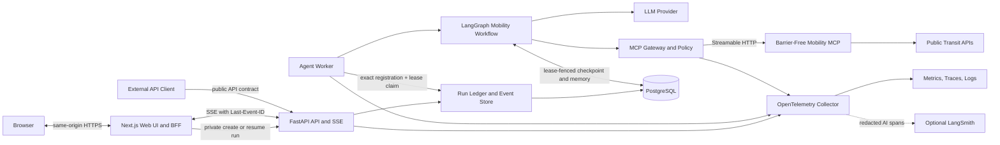
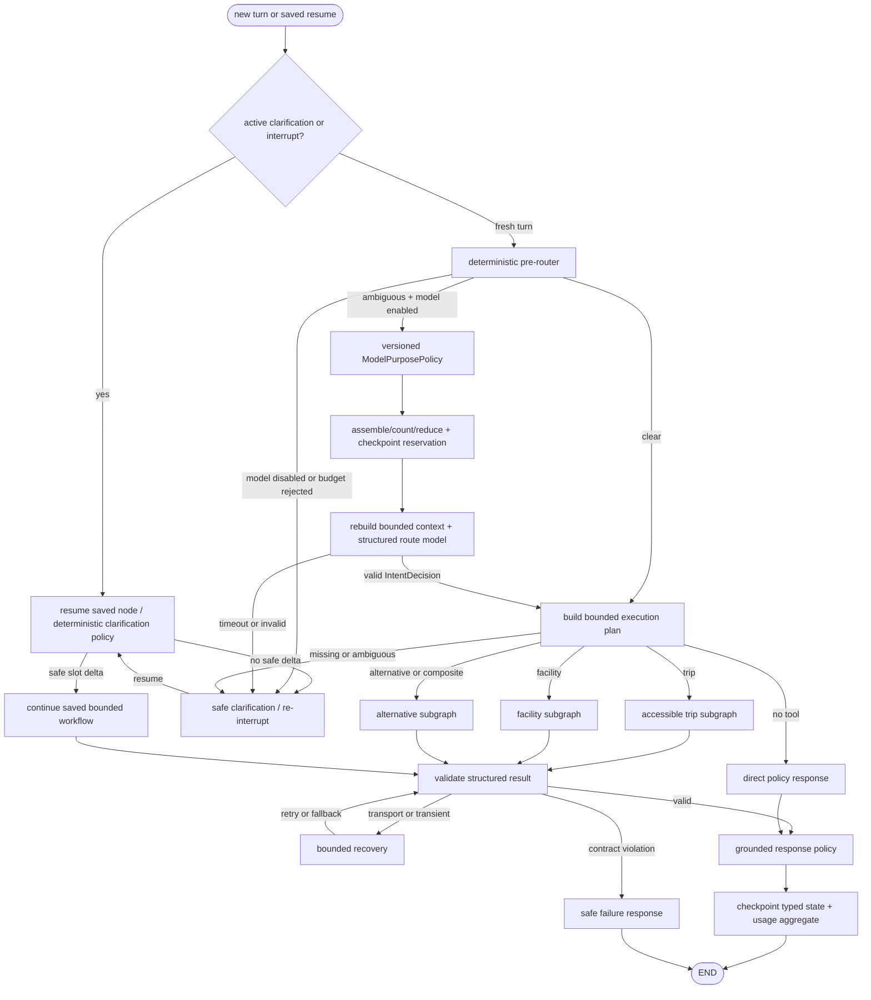

# 시스템 아키텍처

## 1. 설계 배경

Barrier-Free Mobility Agent는 동일 저장소의 Next.js Web UI·BFF와 FastAPI/LangGraph runtime을 합친 하나의 웹 기반 Agent 제품이다. Barrier-Free Mobility MCP만 별도 독립 프로젝트로 두며 역·경로·편의시설 데이터를 정규화하고 규칙 기반으로 이동 위험도와 근거를 계산한다. Agent 제품은 이 판단을 대신하지 않고 다음 문제를 해결한다.

- 사용자가 여러 턴에 걸쳐 제공한 출발지, 목적지, 이동 조건과 현재 경로를 유지한다.
- 질문의 의도와 정보 충족도를 판단해 필요한 MCP Tool만 선택한다.
- 한 번의 Tool로 해결되지 않는 후속 질문을 제한된 playbook으로 조합한다.
- MCP, 모델, 저장소의 실패를 구분하고 재시도·중단·복구 정책을 적용한다.
- 사용자에게 진행 상태를 스트리밍하고 모든 실행을 추적·평가할 수 있게 한다.

현재 MCP 서버는 8개 Tool을 제공한다.

| Tool | 주 용도 | Agent 정책 |
|---|---|---|
| `answer_accessibility_question` | 일반 한국어 이동·시설 질문 | 독립적인 자연어 질문의 기본 경로 |
| `generate_accessibility_brief` | 구조화된 출발지·목적지·이동 조건 | 문맥이 채워진 이동 판단의 기본 경로 |
| `check_accessible_trip` | 상세 구조 검증 | 내부 검증·평가용, 일반 최종 응답에는 우선하지 않음 |
| `resolve_station` | 역명·별칭 해석 | 모호한 역명 확인용 |
| `get_station_facilities` | 역 편의시설 목록 | 보조 조회 전용 |
| `get_elevator_status` | 승강기 상태 | 보조 조회 전용 |
| `get_accessible_restroom` | 장애인화장실 | 보조 조회 전용 |
| `get_route_candidates` | 경로 후보 | 설명·대안 탐색용, 이동 안전 판정의 대체 수단 아님 |

세부 조회 Tool 네 종류는 내부 서비스의 실패 메타데이터를 제거하고 값만 반환한다. 빈 배열이 실제 시설 없음인지 조회 실패인지 구별되지 않을 수 있다. 따라서 `SUCCESS | PARTIAL | FAILED | NEEDS_CLARIFICATION`, `failed_sources`, `limitations`, `confidence_level`, `UNKNOWN`을 보존하는 복합 Tool을 이동 판단의 기준으로 사용한다.

## 2. 아키텍처 원칙

1. **판단과 오케스트레이션을 분리한다.** 위험 점수와 이동 가능성은 MCP가, 문맥과 실행 흐름은 Agent가 소유한다.
2. **결정론적 경로를 우선한다.** LLM은 제한된 구조화 분류와 설명에 사용하고, Tool 이름·순서를 마음대로 생성하지 않는다.
3. **불확실성을 숨기지 않는다.** 부분 실패와 오래된 데이터는 재작성 과정에서도 그대로 유지한다.
4. **상태를 메시지 문자열에만 담지 않는다.** 이동 조건, 장소, 근거와 미해결 질문은 타입이 있는 필드로 관리한다.
5. **실행 예산을 코드로 강제한다.** 모델 호출, Tool 호출, 그래프 단계, 병렬성, 토큰, 시간을 제한한다.
6. **재실행 가능하게 만든다.** 외부 I/O는 독립 노드로 분리하고 run idempotency key와 Tool ledger ID를 부여한다. MCP 호출 자체는 at-least-once로 다룬다.
7. **관측 정보도 제품 계약이다.** `trace_id`, `run_id`, `thread_id`, flow/model/prompt/tool-schema 버전을 전 구간에 전달한다.
8. **민감한 문맥은 최소 보관한다.** 위치와 이동 제약은 필요한 기간만 저장하고 장기 기억은 사용자가 확인한 값만 기록한다.

## 3. 기술 선택

| 영역 | 선택 | 이유 |
|---|---|---|
| 언어 | Python 3.13 | 최신 LangGraph·MCP·관측 생태계와 async I/O를 직접 사용한다. MCP 서비스와는 HTTP 계약으로 분리한다. |
| Web | TypeScript strict + Next.js App Router | 사용자 Assistant, 운영 Console과 same-origin BFF를 동일 제품의 `web/` 계층에서 제공한다. |
| 패키지 | uv + `pyproject.toml` + `uv.lock` | 빠른 재현 환경, 단일 메타데이터, CI의 locked install을 지원한다. |
| Agent runtime | LangGraph 1.2 Graph API | 상태·분기·병렬 실행·checkpoint·interrupt·retry 경로를 명시적으로 표현한다. |
| LLM/MCP integration | LangChain 1.3 + `langchain-mcp-adapters` 0.3 | 모델 추상화와 MCP structured artifact 변환만 사용한다. |
| MCP SDK | 1.x (`>=1.27,<2`) | 2.x pre-release 도입을 막고 안정 계약을 유지한다. |
| HTTP API | FastAPI 0.139 + Pydantic v2 | async API, OpenAPI, 공식 SSE와 타입 기반 validation을 제공한다. |
| 상태 저장 | PostgreSQL + `AsyncPostgresSaver` + conversation repository | thread checkpoint, 재개, 공개 run metadata, Phase 4A 내부 run/event 원장과 Phase 4B-2 암호화 실행 queue를 저장한다. opt-in 장기 기억용 `AsyncPostgresStore`는 후속이다. |
| 캐시/분산 제어 | 초기에는 없음, 필요 시 Redis | rate limit, 짧은 결과 캐시, pub/sub 용도로만 추가하고 상태 원본으로 쓰지 않는다. |
| 관측 | OpenTelemetry + 구조화 logging | vendor-neutral trace/metric 전파. LangSmith는 AI trace와 eval용 선택 backend다. |
| 품질 | Ruff, mypy strict, pytest, Testcontainers | 정적 검사, 타입 경계, 실제 Postgres/MCP contract를 자동 검증한다. |

`pyproject.toml`은 호환 minor 상한을 두고 `uv.lock`이 실제 버전을 고정한다. 라이브러리 버전 업그레이드는 Renovate/Dependabot PR에서 contract·eval 전체를 통과한 경우에만 반영한다.

## 4. 논리 시스템 구성

아래 그림은 현재의 API/worker 분리와 향후 SSE·관측 계층까지 포함한 목표 구성이다. Phase 4B-3C는
Agent 1개·Worker 2개 범위의 release-gate 자동화까지 제공하지만 일반 제품 실행은 단일 API와 단일
worker로 유지한다. 새 watcher 경로의 smoke 재검증은 대기 중이고 정식 4시간 release profile도
미실행·미승인이며 SSE도 활성화하지 않았다.



Phase 4A에서는 worker를 도입하기 전에 API process가 graph를 동기 실행하며
다음 내부 실행 원장을 구현·검증했다.

1. API service가 graph 전에 public run ID를 선할당한다.
2. run record, thread active pointer와 sequence 1의 `run.started`를 같은 transaction으로 예약한다.
3. invocation별 request/run/thread correlation을 immutable RuntimeContext로 graph와 Tool recorder에
   전달한다.
4. `run_events`가 run과 Tool transition의 전체 순서를 저장한다.
5. Tool terminal event와 같은 transaction에서 started/terminal sequence를 참조하는 immutable
   `tool_executions` summary를 한 번 저장한다.
6. graph 결과의 public `ConversationRun` snapshot과 terminal/interrupted event를 같은 metadata
   transaction으로 확정한다.

public snapshot은 기존 schema v3/v4 의미를 유지하고 내부 `running` execution과 분리한다.
LangGraph checkpoint, Agent ledger와 외부 MCP 호출은 서로 다른 transaction이므로 checkpoint 전후
crash window를 허용한다. Phase 4A는 open execution과 open Tool attempt를 내부에서 탐지하지만
자동 replay, event repair 또는 active pointer 해제를 하지 않는다. 기존 stateless
`/v1/accessibility/questions`는 이 ledger 범위에서 제외한다.

Phase 4B는 [ADR-0011](adr/0011-staged-durable-execution-coordination.md)에 따라 세 단계로
활성화한다. Phase 4B-1의 atomic idempotency reservation, invocation별 durable job과
lease·heartbeat·fencing substrate 위에 Phase 4B-2 worker 경로를 활성화했다. BFF start/resume은 매
mutation에 idempotency key를 전달하고 API는 run/event/job을 원자적으로 예약한다. 별도 worker가
lease로 claim하는 동안 API는 기존 public snapshot이 확정되기를 bounded wait한다. 호환 기간에는
key 없는 native 요청과 memory backend만 기존 process의 동기 graph 경로를 사용한다.

Phase 4B-3A는 PostgreSQL schema v9의 fenced Worker registry와 idle heartbeat를 추가했다. 신규
durable reservation은 replay 확인 뒤 ready·unexpired Worker row와 직렬화되며, Worker가 없으면
run/event/job을 만들지 않고 `EXECUTION_WORKER_UNAVAILABLE`로 fail closed한다. API의 공개
readiness와 Worker의 registry/CLI probe는 분리한다. queue health는 개별 owner·질문·payload 없이
age, lease, recovery와 stuck count만 집계한다.

Phase 4B-3B는 Worker identity, claim과 checkpoint까지 fencing 경계를 닫는다. Compose의 auto identity는
container hostname을 사용하고 health probe는 mode-0600 process-local state의 token·generation과
PostgreSQL registry row가 정확히 일치해야 성공한다. job claim도 이 exact ready·fresh registration에
결합한다. LangGraph checkpoint write는 current execution lease row를 잠근 채 saver를 호출하고,
checkpoint metadata에는 correlation, execution job ID와 lease generation provenance를 남긴다. forced
shutdown이 grace를 넘기면 active lease를 revoke해 취소를 무시한 task의 늦은 write를 차단한다.
checkpointer adapter는 모든 async saver access를 process-local outer lock으로 직렬화하며, write는
outer lock 뒤에 lease row guard를 얻는 고정 순서를 사용한다. 이는 saver 내부 lock과 PostgreSQL
pool/lease lock의 inversion을 막는 ordering 경계이고 cross-process fencing authority는 계속 DB row다.

실제 PostgreSQL의 복수 claim 경쟁, stale delayed write와 checkpoint/reclaim 직렬화, 별도 subprocess
hard-kill 뒤 generation 2 START recovery를 검증했다. Compose에서도 서로 다른 auto identity의 Worker
두 개가 동시에 ready가 되는 core scale 경계를 확인했다. 실제 질문은
`generation = claim_count = 1`과 payload scrub으로 완료됐다. Worker 하나의 단발 stop/start 중 다른
Worker가 ready를 유지했고 Agent만 recreate해도 Worker container는 교체되지 않았으며, 중단 run 조회와
기존 clarification resume이 완료됐다. 이는 correctness gate 완료이지 일반
multi-replica 운영 승인이 아니다.

Phase 4B-3C runner는 local/test Compose의 Agent 1개·Worker 1개 토폴로지에서 시작해 Worker만 2개로
확장한다. 두 Worker를 모두 중지한 admission fail-closed, workload와 겹친 반복 Worker rolling, Agent
recreate 후 clarification resume, PostgreSQL 일시 장애의 정확한 `503 PERSISTENCE_UNAVAILABLE`과 복구를
실행한다. Agent는 전체 gate 동안 1개로 고정하며 key 없는 호환 동기 경로의 process-local 경계를
수평 확장하지 않는다. 즉 3C가 판정하는 안전 범위는 `Agent = 1, Worker = 2`다.

rolling 동안의 peer invariant는 Docker health polling으로 대체하지 않는다. 선택한 Worker container
내부의 long-lived watcher가 mode-0600 process-local token·generation과 PostgreSQL registry의 exact
registration을 DB clock 기준으로 250ms마다 확인한다. Worker rolling에는 peer 하나, Agent recreate에는
두 Worker 모두를 감시한다. queue observer는 Agent container 안의 long-lived
`execution_health_watch` stream 하나이며 smoke 2초·release 5초 간격으로 DB-clock aggregate를 보낸다.
Agent recreate 뒤에는 stream을 다시 열고 각 수렴 판정은 호출 이후의 fresh 표본을 요구한다.

고정 smoke profile은 600초 동안 동시 2개 workflow를 5초 간격으로 예약하고 Worker roll 3회, Agent
recreate 2회, PostgreSQL outage 1회를 요구한다. 고정 release profile은 14,400초 동안 동시 4개를
20초 간격으로 예약하고 각각 12회, 6회, 3회를 요구한다. 평가 하한은 smoke 30개, release 600개지만
실제 예정 workflow 수는 각각 240개와 2,880개다. 공통 budget은 queue warning 15초, failure 60초,
stuck 120초, recovery convergence 90초, final drain 120초다. expired lease, 예상하지 않은 recovery,
terminal payload 잔존, terminal event 위반, ambiguous recovery와 drain 뒤 active job은 허용하지 않는다.

queue 표본과 실행 창의 누적 database evidence는 ID·질문·payload 없는 closed aggregate schema로
수집한다. 결과 report는 profile, Compose digest, image provenance, aggregate workload/scenario/observer,
stable 판정 code와 cleanup 상태만 atomic JSON으로 저장한다. cleanup은 PostgreSQL 복구, Worker 1개로
원복, 제품 health·registry 확인과 생성 thread 삭제까지 포함하며 하나라도 실패하면 gate가 실패한다.
smoke는 항상 release 부적격이다. 새 watcher 경로를 적용한 smoke 재검증은 대기 중이고 정식 4시간
release profile도 미실행·미승인이므로 현재 기본 토폴로지는 계속 Agent 1개·Worker 1개다.

worker 종료 뒤 자동 실행은 lease 만료만으로 허용하지 않고 checkpoint cursor, 마지막 run event와
open Tool attempt를 함께 분류한 뒤 같은 run/checkpoint에서 재개한다. open Tool attempt가 남은
모호한 구간은 자동 replay하지 않고 recovery-required로 중단한다.
PostgreSQL checkpointer는 상태를 복구해도 중단된 HTTP request를 queue에 다시 넣지 않으므로 durable
job은 checkpoint와 별도 authority로 유지한다. checkpoint가 없고 같은 attempt의 open Tool도 없는
START 안전 구간은 입력부터 재실행할 수 있지만, `tool.started`만 남은 모호한 구간은 자동 replay하지
않는다. core fault-injection이나 smoke profile을 통과했더라도 정식 4시간 release profile과 수동
evidence 검토 전에는 Worker replica를 늘리지 않는다. Agent replica는 이 release 범위 밖이며 계속
1개로 유지한다.

현재 MCP Tool은 읽기 전용이므로 외부 호출 의미는 at-least-once다. Agent의 idempotency key는 중복
run 생성을 막지만 MCP가 같은 key를 처리하지 않는 한 end-to-end exactly-once를 보장하지 않는다.
쓰기 Tool은 MCP 자체 idempotency와 사용자 승인 계약 없이는 등록하지 않는다. run ledger의 crash
의미론은 [ADR-0010](adr/0010-durable-run-ledger-and-crash-semantics.md)을 함께 따른다.

## 5. 코드 구조

```text
barrier_free_mobility_agent/
├─ web/                           # 동일 제품의 Next.js UI와 same-origin BFF
│  ├─ src/app/                    # 현재 /assistant·/api/agent, Phase 3C public/protected routes
│  ├─ src/features/assistant/     # conversation, clarification와 result
│  ├─ src/server/agent-api/       # private Agent client와 BFF adapter
│  ├─ src/contracts/              # generated schema와 runtime validation
│  ├─ src/components/             # semantic primitives와 product shell
│  ├─ src/theme/                  # token source와 generated CSS
│  └─ package.json                # 실제 버전은 Web lockfile로 고정
├─ src/barrier_free_mobility_agent/
│  ├─ api/
│  │  ├─ app.py                 # FastAPI factory와 lifespan
│  │  ├─ dependencies.py
│  │  ├─ middleware/            # correlation, auth, rate limit
│  │  ├─ routes/                # threads, runs, events, health
│  │  └─ schemas/               # 외부 API 계약
│  ├─ application/
│  │  ├─ ports/                 # GraphRunner, McpGateway, RunRepository
│  │  └─ services/              # run 생성·재개·취소 use case
│  ├─ agent/
│  │  ├─ graph.py               # top-level graph 조립만 담당
│  │  ├─ state.py               # checkpoint 가능한 상태 계약
│  │  ├─ context.py             # 요청 단위 immutable runtime context
│  │  ├─ nodes/                 # 한 책임을 갖는 node
│  │  ├─ subgraphs/             # trip, facility, alternative playbook
│  │  ├─ routers/               # enum 기반 conditional edge
│  │  ├─ policies/              # tool, response, token, retry 예산
│  │  └─ prompts/               # 버전이 있는 최소 prompt
│  ├─ domain/
│  │  ├─ models/                # intent, mobility, evidence, error
│  │  └─ services/              # Agent 소유의 순수 정책
│  ├─ integrations/
│  │  ├─ llm/                   # provider factory와 structured output
│  │  └─ mcp/                   # client, registry, interceptor, DTO mapper
│  ├─ persistence/
│  │  ├─ checkpoint.py
│  │  ├─ memory.py
│  │  ├─ run_repository.py
│  │  └─ artifact_repository.py
│  ├─ observability/             # logging, tracing, metrics, redaction
│  ├─ worker/                    # lease, executor, recovery sweeper
│  └─ config.py
├─ tests/
│  ├─ unit/
│  ├─ graph/
│  ├─ contract/
│  ├─ integration/
│  ├─ e2e/
│  └─ evals/
├─ docs/adr/
├─ deploy/
└─ scripts/
```

`web/`과 Python source는 같은 제품 저장소에 있지만 runtime 책임은 분리한다. Web은 공개 schema의 presentation과 interaction만 소유하고 intent, mobility semantics나 Tool routing을 다시 구현하지 않는다. `domain`에는 MCP의 위험 계산을 복사하지 않는다. MCP 응답 DTO도 필요한 필드만 anti-corruption layer에서 별도로 검증하고 별도 MCP 프로젝트의 Python 모듈을 import하지 않는다.

## 6. LangGraph 흐름

현재 runtime은 deterministic pre-router와 fixed Tool playbook만 사용하며 실제 model 호출은 0회다.
`ModelPurposePolicy`, strict model-only intent/context 계약, reservation 정산 코어와 offline corpus
gate, 첫 hosted candidate adapter와 보호형 live evaluator는 구현되어 있다. 아래 흐름의
reservation/model graph node 연결은 두 후보 이상의 평가·선택 뒤
[ADR-0006](adr/0006-bounded-model-context-and-token-accounting.md)의 다음 Stage B runtime slice다. model이
활성화되어도 명확한 질문은 기존 model 0회 경로를 유지한다.



state byte hard gate는 restore 뒤 한 번 실행하는 node가 아니다. 각 application node가 update를
반환하기 전에 기존 state와 merge한 top-level/nested state를 검사하고, `interrupt()` payload도
호출 전에 별도로 검사한다. framework metadata와 checkpoint history는 saver metric·retention으로
분리한다. LangGraph가 `source=input` checkpoint를 쓰기 전에도 runner가 latest state와 start 또는
business-clarification input update를 merge해 같은 preflight를 수행한다.

### 6.1 Hybrid router

Router는 두 층이다.

1. 코드 기반 pre-router가 명령, 짧은 후속 질문, 현재 thread 상태와 필수 slot을 확인한다.
2. 분류가 불확실할 때만 작은 모델이 `IntentDecision` Pydantic schema를 채운다.

모델은 MCP Tool 이름을 보거나 직접 선택하지 않는다. strict output은 `intent`, `confidence`만 반환하며, confidence gate·missing field·required capability는 코드 projector가 다시 계산한다. intent-to-capability는 하나의 code-owned domain mapping을 공유하고 최종 허용 Tool·호출 한도는 versioned `ToolPolicy`가 결정한다. 동일 질문을 다시 실행해도 허용 Tool 집합과 최대 단계가 안정적으로 유지된다.

모델 provider와 이름은 아키텍처에 고정하지 않는다. OpenAI Responses immutable snapshot을 쓰는
첫 candidate adapter와 보호형 평가기는 구현됐지만 운영 후보로 선정되거나 graph에 연결되지 않았고,
모든 playbook의 `max_model_calls=0`이다. structured fallback을 활성화하기 전에 한국어 slot 추출, strict
structured output 준수율, tokenizer undercount, p95 latency와 건당 비용을 같은 fixture로
두 후보 이상에서 3회 반복 비교해 하나의 기본 모델을 선택한다. 초기 model은 ambiguous routing만 담당하며 summary model은
기본 도입하지 않는다. provider별로 지원하지 않는 temperature나 reasoning 옵션은 공통 설정처럼
무조건 전달하지 않는다.

### 6.2 Tool playbook

| 상황 | 실행 |
|---|---|
| 인사, 기능 설명, 지원 범위 | Tool 없이 정책 응답 |
| 정보가 부족하거나 장소가 모호함 | `resolve_station` 또는 `interrupt()`로 한 번에 필요한 질문만 요청 |
| 문맥 없는 일반 자연어 질문 | `answer_accessibility_question` 한 번 |
| thread에 출발지·목적지·이동 조건이 구조화됨 | `generate_accessibility_brief` 한 번 |
| capability가 확인된 역 시설 질문 | 의미 제한 wrapper를 통해 `answer_accessibility_question` 한 번 |
| 상세 감사·회귀 평가 | `check_accessible_trip`, 외부 사용자 응답에는 canonical message 유지 |
| 경로 판단 뒤 특정 역의 시설 세부 위치 | structured route stop 계약 전에는 역 이름 clarification |
| 경로상 여러 시설의 보조 확인 | 후속 composite subgraph 전에는 지원 범위를 설명 |
| “현재 경로 말고 다른 경로”, “대안 경로” | 경로 판단과 같은 흐름으로 이전 역·이동 조건을 이어 쓰고 `generate_accessibility_brief(compare_alternatives=true)`를 한 번 부른다. MCP가 검증한 `alternatives`를 답하고, 없으면 비교할 경로가 없다고 밝힌다 |

기본 실행 예산은 모델 호출 2회, MCP Tool 호출 6회, 병렬 호출 4개, graph step 12개다. 요청별 playbook이 더 낮은 제한을 가질 수 있다. 예산 소진은 모델에게 추가 자율성을 주는 대신 안전한 부분 응답으로 종료한다.

Phase 2C에서 `get_station_facilities`, `get_elevator_status`, `get_accessible_restroom`은 값 배열만 반환해 실패 출처·제한·신선도를 잃으므로 authoritative 판단에 사용하지 않는다. 역 시설 결과는 canonical message와 부분 실패를 보존하는 복합 질문 Tool만 사용한다. “환승역 화장실도 필요해”는 아직 structured transfer stop이 없으므로 route summary를 파싱하지 않고 구체적인 역을 다시 묻는다. 향후 route stop 계약이 생기면 기존 profile에 `need_accessible_restroom=true`, `accessible_restroom_requirement=TRANSFER`를 반영해 경로 전체를 다시 검증한다. `get_route_candidates`의 후보도 복합 결과가 접근 가능성을 확인하지 않은 상태에서는 접근 가능한 대안으로 표현하지 않는다.

현재 MCP에는 이전 route ID, 제외할 노선·경로 또는 특정 후보를 다시 위험 평가하는 입력이 없다. 따라서 `alternatives`에 없는 임의 후보를 Agent가 “다른 접근 가능 경로”로 재평가하지 않는다. 이 기능은 MCP에 route exclusion 또는 candidate evaluation Tool이 추가된 뒤 별도 playbook으로 확장한다.

### 6.3 MCP 호출 정책

- `MultiServerMCPClient`의 HTTP transport를 사용하고 현재 서버는 stateless session으로 호출한다.
- startup에서 Tool 목록·입력 schema를 가져와 필수 capability와 대조하고 schema fingerprint를 기록한다.
- Bearer/OIDC 처리는 `httpx.Auth` 또는 MCP interceptor에 격리한다.
- `structuredContent`/`MCPToolArtifact`를 먼저 사용하고 문자열 JSON 재파싱은 호환 fallback으로만 둔다.
- `handle_tool_errors=False`로 설정해 Tool 오류를 LLM에게 무제한 재계획시키지 않고 graph의 오류 분류기로 보낸다.
- MCP의 answer-policy resource와 prompt는 startup 시 version/hash를 확인하되 매 요청의 모델 prompt에 전체를 반복 삽입하지 않는다.
- 모든 현재 Tool은 읽기 전용으로 분류한다. 향후 쓰기 Tool은 별도 risk class, 사용자 승인과 idempotency key 없이는 등록할 수 없다.
- MCP의 문자열 Tool 입력은 현재 기본 120자 제한이다. Agent API는 더 긴 사용자 메시지를 받을 수 있지만 raw text를 조용히 잘라 전달하지 않는다. 긴 질문은 구조화 slot으로 추출해 `generate_accessibility_brief` 경로로 보내거나 의미를 보존하는 명확화 질문을 한다.
- MCP HTTP 응답은 압축을 거부하고 일반 body는 1 MiB, SSE는 event당 1 MiB를 넘기기 전에 중단한다. 세션별 value-free violation latch가 MCP SDK 내부에서 소비되는 stream 예외를 session operation과의 race로 즉시 회수하므로, payload 위반이 긴 408 timeout이나 다른 동시 세션의 실패로 바뀌지 않는다. violation 경로는 해당 HTTP client를 먼저 bounded abort한 뒤 session task를 취소하며, 정상·오류 종료의 graceful DELETE도 별도 250ms best-effort 예산으로 제한해 cleanup이 Tool 응답을 지연하지 못하게 한다. decoded Tool result는 문자열 10,000자, 배열·object field 100개, canonical JSON 262,144 bytes와 depth/node 상한을 다시 적용한다. Tool discovery도 최대 16 page·64 Tool·1 MiB로 제한하고 cursor cycle과 중복 Tool 이름을 거부한 뒤에만 schema fingerprint를 계산한다.
- MCP `/health`는 HTTP 200이어도 payload가 degraded일 수 있고 외부 공공 API를 실제 호출하지 않는다. readiness는 별도 health URL의 payload, Tool schema fingerprint와 최근 호출 상태를 함께 보며, 매 probe마다 비싼 복합 Tool을 실행하지 않는다.

## 7. 상태와 문맥

Graph state는 checkpoint에 저장되는 serializable 값만 포함한다.

```text
AgentState
├─ schema_version, flow_version, current_input
├─ trip_context
├─ mobility_context                  # true | false | unknown + provenance
├─ facility_context
├─ intent_decision, execution_plan
├─ pending_clarification
├─ origin/destination_resolution     # bounded temporary projection
├─ mcp_profile, projection_assumptions
├─ final_outcome, external_error
├─ turn graph/tool/model counters and ledgers
├─ run graph/tool counters and ledgers
└─ run_usage                         # ADR-0006 schema 1 aggregate, checkpoint authority
```

`AgentState`에는 현재 `recent_messages`나 `conversation_summary`가 없다. 새 turn은
`current_input`, 결과와 turn ledger를 덮어쓰고 다음 항목만 의도적으로 유지한다.

`pending_clarification`은 route/MCP business clarification을 나타낸다. station selection은 nested
subgraph task와 LangGraph interrupt payload가 source of truth이므로 top-level field로 복제하지
않고 saved node를 그대로 resume한다. active clarification/interrupt는 ambiguous model fallback보다
항상 우선하며 context reduction 대상이 아니다.

```text
Retained typed context
├─ mobility_context
├─ trip_context
└─ facility_context
```

Agent의 `mobility_profile`은 MCP DTO와 다르게 안전 관련 boolean을 `true | false | unknown`으로 표현한다. `unknown`은 MCP의 Pydantic 기본값으로 채우지 않는다. 특히 계단·에스컬레이터 사용 가능 여부처럼 판단을 바꿀 수 있는 값이 확인되지 않으면 outbound `MobilityProfile`을 만들기 전에 clarification으로 보낸다. MCP mapper는 필요한 필드를 모두 명시적으로 채우며 기본 생성자를 안전 판단의 근거로 사용하지 않는다.

### 7.1 단기 상태

제품 Compose에서는 `AsyncPostgresSaver`가 thread별 slot, 계획과 interrupt 위치를 저장하고, 별도 `agent_threads`·`agent_runs` repository가 공개 run 조회와 owner mapping을 저장한다. 두 계층이 모두 있어야 process 재시작 뒤 같은 run을 조회하고 clarification을 이어갈 수 있다. checkpoint의 실제 key는 `<owner_id>:<public_thread_id>`로 구성해 다른 owner namespace와 분리한다. native test는 같은 계약의 `InMemorySaver`와 memory repository를 사용한다. `flow_version`과 `state_schema_version`을 thread metadata와 graph state에 함께 기록하고 불일치는 새 run 전에 거부한다. `agent_runs.payload_schema_version`도 저장 payload를 decode하기 전에 확인해 호환되지 않는 run을 거부한다. node/state data migration은 add → dual-read/write → 기존 run drain → remove 순서로 배포한다.

Phase 4A 계약은 public `ConversationRun` snapshot과 내부 execution phase를 분리하고,
`run_events`를 commit된 실행 순서의 source of truth로 추가한다. Tool의 started/terminal transition은
모두 event로 남고 terminal transaction이 `tool_executions` immutable summary를 한 번 INSERT한다.
checkpoint의 `tool_ledger`와 `run_tool_ledger`는 실행 budget용 bounded 이름 목록이며 durable attempt
원장으로 사용하지 않는다. migration 전 run에는 실제 event를 만들어내지 않고 내부 projection에서
`legacy/incomplete ledger`로 구분한다. 이 계약은 구현·fault-injection 검증을 완료했으며 worker
복구나 public event API를 의미하지 않는다.

Phase 4B의 durable queue는 run이 아니라 start/resume invocation 단위다. 한 run에 여러 resume가
이어질 수 있으므로 job은 request ID, execution attempt, payload schema, coordination state, lease와
증가하는 fencing token을 독립적으로 가진다. `run_events`는 실행 사실과 순서, job row는 실행권,
checkpoint는 업무 state와 interrupt 위치의 authority다. lease 만료나 어느 한 계층의 값만으로 다른
계층을 silent repair하지 않는다.

Phase 4B-3B의 checkpointer adapter는 process 안의 `aget_tuple`, `alist`, `aput`, `aput_writes`와
thread delete를 하나의 outer lock으로 직렬화한다. Worker graph의 write는 outer lock을 먼저 얻고
current execution lease guard 안에서 실행한다. PostgreSQL guard는 job row를 `FOR UPDATE`로 잠그고 DB
clock, lease token과 generation을 검증한 transaction을 saver write가 끝날 때까지 유지한다. 이 단일
lock order는 실제 2-worker vertical smoke에서 관측한 saver 내부 lock과 pool/lease lock inversion을
방지하며 회귀 테스트로 고정된다. 따라서 checkpoint write와 reclaim은 직렬화되고, reclaim이 먼저
commit된 뒤 stale writer가 checkpoint를 추가할 수 없다. process-local outer lock은 scheduling
경계일 뿐 cross-process correctness를 대신하지 않는다. guard가 보유한 connection과
`AsyncPostgresSaver` connection이 동시에 필요하므로 PostgreSQL pool max size는 최소 2다.
checkpoint에는 correlation 외에 execution job ID와 lease generation provenance를 남기고, 교체 claim은
같은 job의 이전 generation checkpoint만 recovery 후보로 인정한다. private lease token은 checkpoint
metadata에 저장하지 않는다.

worker가 필요한 질문·clarification 답변은 redacted event가 아니라 private job payload에만 둔다.
Phase 4B-2는 closed schema와 크기 제한에 더해 AES-256-GCM과 job/owner/correlation/operation/schema
AAD를 적용하고 job terminal transaction에서 ciphertext를 scrub한다. active key와 decrypt-only
previous keyring을 지원하며 queued/leased payload의 key fingerprint가 keyring에 없으면 startup에
실패한다. hosted 경로는 PostgreSQL verified TLS와 database at-rest encryption 확인도 요구한다.
idempotency 비교에는 key 원문이나
평문 payload hash 대신 `operation + target + client key`를 domain-separated HMAC으로 계산한 scoped
digest를 owner column과 함께 저장하고, server-secret 기반 request fingerprint만 남긴다. 같은 raw
key라도 target이 다르면 scoped digest가 다르며, 같은 digest가 다른 target과 함께 들어오면 caller
오류 또는 충돌로 보고 거부한다. memory 구현은 contract test 경로일 뿐 durable recovery를 제공하지
않는다.

thread 삭제는 PostgreSQL schema v8 deletion fence를 먼저 설정한다. queued/leased job이 있으면
삭제를 거부하고, fence가 있는 동안 start/resume reservation도 거부한다. 따라서 별도 worker가
checkpoint를 쓰는 동안 checkpoint-first cleanup이 metadata cascade와 경합하지 않는다. checkpoint
cleanup 실패 시 fence를 유지해 같은 owner가 안전하게 재시도하고, 같은 token으로만 최종 cascade한다.
claim 중 ciphertext 인증에 실패한 job은 terminal로 격리·scrub해 poison job 한 건이 queue 전체를
head-of-line blocking하지 않게 한다.

### 7.2 장기 기억

Phase 3B 후속에서 `AsyncPostgresStore`를 도입할 때는 사용자가 장기 저장에 명시적으로 동의한 이동 선호만 저장한다. 현재 구현에는 장기 기억 Store가 없다. 반복 언급이나 모델 추론은 동의로 간주하지 않는다.

- 저장 가능: 휠체어 사용, 계단 사용 불가, 엘리베이터만 사용, 최대 환승 횟수처럼 다음 대화에 유용한 조건
- 기본 미저장: 원문 전체 대화, 일회성 출발지·목적지, 상세 이동 이력, 모델이 추측한 장애 정보
- 모든 항목에 `source`, `confirmed_at`, `expires_at`, `schema_version`을 둔다.
- 조회·수정·철회·삭제 API를 제공한다. 철회 또는 계정 삭제는 store뿐 아니라 관련 checkpoint, Tool artifact와 run/event payload까지 삭제하거나 법적·운영상 필요한 최소 ledger만 비식별화한다.

### 7.3 Tool artifact

현재 원본 MCP 응답은 메시지와 state에 복제하지 않는다. Phase 3B 후속에서 artifact 저장소를 도입하면 암호화해 짧게 보관하고 state에는 `artifact_id`, schema hash, 핵심 근거와 canonical `user_message`만 둔다. 보존 기간과 삭제 정책은 artifact 저장소를 구현할 때 설정 계약으로 확정한다. 현재 hosted 설정은 checkpoint serializer key가 없으면 startup에 실패한다.

## 8. 토큰 절약 전략

1. regex/상태 기반 pre-router로 명확한 요청의 분류 모델 호출을 생략한다.
2. intent별 Tool allowlist만 사용하고 8개 schema 전체를 매번 모델에 노출하지 않는다.
3. MCP structured artifact에서 필요한 필드만 `EvidenceView`로 축약한다.
4. 복합 Tool의 canonical `user_message`가 충분하면 최종 생성 모델을 호출하지 않는다.
5. 구조화된 이동 조건과 장소 slot을 authoritative state로 유지하고 자연어 summary로 복제하지
   않는다.
6. model 호출 직전에만 ephemeral `ModelContextEnvelope`를 만들고 prompt 문자열은 checkpoint에
   저장하지 않는다.
7. latest input, active clarification과 confirmed mobility provenance는 절대 줄이지 않고 optional
   evidence/중복 label만 결정론적으로 제외한다.
8. hosted model은 provider/model exact counter를 사전 admission에 사용한다. versioned
   conservative estimator는 local/test와 adapter 평가에만 사용한다.
9. provider `usage_metadata`는 사후 billing/관측의 기준으로 사용하되 호출 전 hard limit의
   근거로 사용하지 않는다.
10. 장기 기억은 인증·동의 계약이 준비된 뒤 namespace와 목적에 맞는 소수 항목만 조회한다.

현재는 hosted model 호출 자체가 없고 recorded offline baseline은 provider 품질 측정이 아니므로
실제 token savings를 주장하지 않는다. 초기 budget target은 다음과 같으며 승인 후보의 실제
wire/token 평가 뒤 model profile 설정 계약으로 확정한다.

| 차원 | 초기 target |
|---|---:|
| merged top-level/nested state와 interrupt payload hard limit | 각각 65,536 bytes |
| application model input cap | 4,096 tokens |
| soft reduction trigger | usable input의 70% |
| reduction target | usable input의 50% |
| output reserve와 provider hard output max | 최소 512 tokens, 동일 값 강제 |
| context safety reserve | 최소 256 tokens |
| run 누적 charged token | 12,000 tokens |
| deterministic context reduction | model invocation당 최대 1 decision |
| LLM digest compaction | 현재 비활성 |
| optional recent turn digest | 최대 6, 기본 비활성 |

호출별 hard input은 application cap과
`provider context window - output reserve - safety reserve` 중 작은 값이다. critical/required
context가 이 limit을 넘으면 최신 질문을 자르지 않고 provider 호출 없이 명확화 또는 budget
error로 종료한다. token reduction, latest state byte limit과 누적 checkpoint history retention은
서로 다른 운영 정책이다. state limit은 각 node update를 기존 값과 merge한 canonical JSON과
`interrupt()` payload에 checkpoint 전에 적용하며 framework metadata와 과거 snapshot은 별도
saver metric·retention 대상으로 둔다. model profile이 context window, output/safety reserve와
hard output parameter를 완전하게 제공하지 않으면 startup에 실패한다.

## 9. 응답 정책

- 복합 MCP Tool의 `user_message`가 있으면 그것을 최종 답변의 기준으로 사용한다.
- `risk_score`, 내부 cache 상태와 원시 source 이름은 사용자가 요청하지 않으면 노출하지 않는다.
- `PARTIAL`, `UNKNOWN`, `failed_sources`, `limitations`, `unverified_parts`를 성공처럼 표현하지 않는다.
- “안전하다”, “반드시 가능하다” 같은 보장 표현을 금지하고 데이터 확인 시각과 출발 직전 재확인 안내를 유지한다.
- 보조 Tool의 빈 배열만으로 시설이 없다고 단정하지 않는다.
- 모델이 보충 문장을 생성하더라도 MCP 근거에 없는 새 경로·시설·운행 상태를 만들 수 없다.
- 사용자에게는 내부 chain-of-thought가 아니라 `요청 이해 → 조회 중 → 근거 확인 → 완료` 같은 진행 event만 제공한다.

## 10. 장애 대응

| 실패 | 재시도 | 처리 |
|---|---:|---|
| 입력 validation, 4xx, schema 오류 | 0 | 명확한 사용자 오류 또는 contract failure |
| MCP connect/timeout/429/5xx | 최대 1회 추가 | jitter backoff, circuit breaker와 전체 deadline 적용 |
| MCP Tool `isError` | 분류 후 결정 | 모델에 그대로 넘기지 않고 typed error로 변환 |
| MCP `PARTIAL`/`NEEDS_CLARIFICATION` | transport retry 없음 | 정상 business outcome으로 분기 |
| MCP response schema drift | 0 | fail closed, readiness 경고와 alert |
| structured route model timeout/429/5xx | 0 | reservation을 unknown-charge하고 deterministic clarification |
| model 전체 장애 | 0 이후 fallback | optional model이면 deterministic route/명확화, 필수화 전 paid readiness probe 금지 |
| PostgreSQL 장애 | 요청 중단 | readiness 실패, checkpoint 없는 운영 실행 금지 |
| Phase 4B-3C PostgreSQL outage 중 mutation | 0 | 정확한 retryable `503 PERSISTENCE_UNAVAILABLE`, POST 재전송 없이 DB·Worker·Web 수렴 확인 |
| Phase 4A process crash | 자동 재시도 없음 | open execution/Tool 후보를 탐지하고 같은 thread의 새 run 차단 |
| key 없는 legacy process crash | 자동 재시도 없음 | 기존 동기 API 경로는 Phase 4A와 같은 open execution 탐지 유지 |
| Phase 4B-2 worker crash | cursor 분류 뒤 bounded recovery | fencing token을 교체하고 같은 run/thread와 exact checkpoint 사용, open Tool ambiguity는 fail closed |
| Phase 4B-1 stale queue claimant | 0 | 현재 fencing token과 다른 queue heartbeat·complete·fail·release 거부 |
| Phase 4B-2/3 stale worker write | 0 | lease-bound Tool event·run finalize transaction에서 현재 token과 generation 검증 |
| Phase 4B-3B stale checkpoint write | 0 | current lease row guard에서 token·generation 검증, reclaim과 직렬화하고 execution provenance 불일치 거부 |
| Worker shutdown grace 초과 | 자동 replay 없음 | active lease를 CAS revoke하고 새 generation이 checkpoint·ledger evidence를 다시 분류, revoke 실패는 handoff 실패 |
| 향후 client SSE disconnect | graph 정책에 따라 계속/취소 | 재연결은 `Last-Event-ID`, 명시 취소는 cancellation 전달 |

MCP 내부가 이미 공공 API를 재시도하므로 Agent의 재시도는 transport 실패에만 작게 적용해 retry 증폭을 막는다. 전체 deadline, Tool deadline과 모델 deadline은 한 요청 budget에서 차감한다.

## 11. API 계약

| Method | Path | 설명 |
|---|---|---|
| `POST` | `/v1/threads` | thread 생성 |
| `DELETE` | `/v1/threads/{thread_id}` | thread와 사용자 소유 상태 삭제 |
| `POST` | `/v1/threads/{thread_id}/runs` | 메시지 제출, BFF는 `Idempotency-Key` 필수·Agent API는 호환 기간 optional |
| `GET` | `/v1/runs/{run_id}` | 상태와 최종 결과 조회 |
| `GET` | `/v1/runs/{run_id}/events` | `Last-Event-ID`를 지원하는 SSE |
| `POST` | `/v1/runs/{run_id}/resume` | clarification/interrupt 재개, Web은 `clarification_id` 필수 |
| `POST` | `/v1/runs/{run_id}/cancel` | 실행 취소 |
| `GET` | `/health/live` | process liveness |
| `GET` | `/health/ready` | API process의 PostgreSQL과 MCP contract readiness; Worker는 registry/CLI로 별도 확인 |
| `GET` | `/metrics` | Prometheus 형식 metric |

이 표는 최종 운영 계약과 호환 상태를 함께 표시한다. 현재 구현은 thread 생성·삭제, run 제출·조회와
resume을 제공하며 backend에 따라 `persistence=ephemeral | durable`을 명시한다. PostgreSQL metadata,
checkpoint, owner 격리와 PostgreSQL/MCP readiness가 활성화되어 있다. Phase 4B-2에서 BFF header,
atomic submit, lease-bound Tool ledger/finalization과 별도 worker를 연결했고 Phase 4B-3A에서 Worker
registry, admission gate와 독립 Docker healthcheck를 추가했다. Phase 4B-3B는 exact registration claim,
lease-fenced checkpoint, checkpoint execution provenance와 forced-stop lease revocation을 연결했다.
BFF는 mutation별 key를
생성하지만 Agent API header는 호환 기간 동안 optional이다. key와 durable coordinator가 있으면 worker
경로, 없으면 기존 동기 경로를 사용한다. bounded wait timeout은 `202`나 가짜 processing run이 아니라
retryable `409`다. 기본 wait는 MCP Tool timeout보다 긴 60초이며 BFF의 90초 deadline 안에 둔다.
resume은 알려진 run을 bounded GET으로 조정하고 start는 사용자의 명시적 결과 확인에서만 보존한 같은
key로 기존 예약에 재결합한다. cancel, SSE replay, public processing response, public Worker readiness
HTTP endpoint와 metrics exporter는 아직 활성화하지 않는다. stateless 단일 질문 endpoint도 Phase 4B
범위에 포함하지 않는다.

Run 응답 schema 3과 4는 `user_message`와 legacy 평면 field 외에 세 safe projection을 제공한다.
한 호환 기간 동안 header가 없으면 schema 3을 반환하고, 동일 제품 BFF는
`X-Agent-Response-Schema: 4`로 schema 4를 선택한다.

- `ConversationContextView`: graph turn 시 생성해 해당 run에 고정한 intent-scoped trip/facility context와 active clarification 요약
- `ClarificationView` v2: 한 active 제출 단위, prompt와 `single_text | fields` answer request,
  `inputs[]`의 stable `id`, `prompt_id`, field, `control`, label·option과 constraints
- `AnswerPresentation`: trip/facility discriminator, typed result summary, safety notice와 allowlisted evidence

Schema 3은 기존 `choice | free_text`, `single_text`와 migration용 deprecated
`questions[]`, `clarification_options[]`를 변경 없이 유지한다. Schema 4의 초기 structured allowlist는
출발지·도착지, 계단·에스컬레이터와 역 후보이며, MCP 후속 질문과 미승인 조합은 clarification
전체를 `single_text`로 projection한다. raw `AgentState`, MCP profile, candidate 원본, Tool ledger,
internal source name과 note는 projection에 포함하지 않는다.

Resume v2는 필수 `clarification_id`와 tagged `single_text | fields` answer를 받으며 legacy
`answer: string` body를 호환 기간 동안 함께 수용한다. field value item은 response input의 `id`를
`input_id`로 참조하고 `{kind: text | choice | tri_state, value}`만 보내며 field와 control을 반복하지
않는다. field answer는 atomic하다. Agent는 lock 안에서
stale ID를 answer validation보다 먼저 409로 거절하고 checkpoint와 run을 바꾸지 않는다. 누락·중복·
추가·kind/control·option 오류도 422 뒤 active state를 유지한다. 검증된 structured answer는
LangGraph `Command` payload로 전달한다. clarification node는 자연어 parser를 거치지 않고 기존
trip/mobility slot에 값을 원자 적용하며 station node는 `option-N`을 checkpoint candidate order에
직접 매핑한다. 안전 필수 `unknown`은 graph terminal branch에서 pending clarification을 제거하고
외부 호출 없이 업무 `FAILED` checkpoint를 정상 완료한다.

Structured resume topology 변경으로 현재 production flow는 `mobility-v2`다. serialized state shape는
변하지 않아 state schema 3을 유지한다. 기존 `mobility-v1` thread는 flow mismatch 검사를 통해 v2
checkpoint로 암묵적으로 재개되지 않는다. 자세한 결정은
[ADR-0009](adr/0009-structured-clarification-contract.md)를 따른다.

MCP startup gate는 기본 trip capability를 검증하고, `facility_result`가 존재할 때 parsed field, nullable, nested item/detail, evidence와 closed enum을 깊게 검증한다. 모두 통과한 경우에만 readiness에 `facility_question` capability를 기록한다. facility extension이 없는 고정 MCP는 trip-only READY이며 시설 요청은 외부 Tool을 호출하지 않고 명시적 지원 한계로 종료한다. 이 방식은 MCP upgrade와 Agent release를 분리하면서 미완성 provider 계약을 조용히 활성화하지 않는다.

다음 SSE event는 후속 단계의 목표 공개 계약이다. Phase 4A의 내부 `run_events` type이나 payload를
그대로 Browser에 전달하지 않는다. owner-scoped projection, 접근 제어와 replay 검증 뒤 별도
schema version으로 공개한다.

- `run.started`
- `agent.status`
- `tool.started`
- `tool.completed`
- `clarification.required`
- `message.delta`
- `message.completed`
- `run.failed`
- `run.completed`

Tool 입력과 원본 결과는 SSE에 싣지 않는다. event ID는 run 안에서 단조 증가하며 재접속 시 누락 event를 저장소에서 재생한다.

## 12. 보안과 개인정보

- 현재 local/demo Web은 HttpOnly signed anonymous session에서 owner ID를 파생하고 BFF shared-token으로 Agent의 trusted-header 경계를 인증한다. native local Agent만 명시적으로 owner 인증을 끌 수 있다.
- anonymous owner는 객체 격리 수단이며 hosted 사용자 신원 인증을 대체하지 않는다. delegated OIDC/JWT와 인증 subject 기반 owner 전환은 hosted UI 활성화 전 후속 계약이다.
- MCP URL은 설정된 allowlist만 허용하고 redirect와 임의 URL 입력을 차단한다.
- MCP token, 모델 key, DB credential은 secret manager 또는 배포 secret로 주입한다.
- 로그와 trace에서 Authorization, 원문 Tool 결과, 정확한 위치 이력, 장애 관련 slot을 기본 redact한다.
- request body, 문자열 길이, 동시 run, 사용자별 rate와 전체 Tool budget을 제한한다.
- MCP Tool 설명과 외부 데이터는 명령이 아닌 비신뢰 데이터로 취급해 prompt injection을 차단한다.
- checkpointer serializer는 strict msgpack과 허용 타입 정책을 사용한다.
- `EncryptedSerializer`가 보호하는 checkpoint payload 범위를 검증하고, saver scalar/metadata·run JSONB처럼 범위 밖인 데이터는 verified DB TLS와 at-rest encryption 또는 별도 application cipher로 보호한다.
- 사용자별 namespace 격리, object-level authorization과 checkpoint/store/artifact/ledger 삭제 전파를 contract test로 검증한다.
- run/event ledger는 closed allowlist DTO만 저장하고 질문, 역명, 이동 조건, Tool argument/result,
  exception 문자열과 owner ID를 복제하지 않는다.
- event와 Tool summary는 살아 있는 thread 안에서 append-only이며 owner-scoped thread 삭제에만
  cascade한다. Phase 4A에는 event 독립 TTL이나 background cleanup이 없다.
- dependency audit, container scan, SBOM 생성과 non-root image를 CI release gate에 둔다.

## 13. 관측성

모든 log/span/metric은 다음 correlation 필드를 공유한다.

```text
trace_id, request_id, run_id, thread_id_hash,
flow_version, state_schema_version,
router_intent, playbook_version,
mcp_server, mcp_tool, tool_schema_hash,
model_provider, model_name, prompt_version,
attempt, fallback_reason, response_status
```

핵심 SLI/SLO 후보:

- API와 전체 run 성공률, p50/p95/p99 latency
- intent routing 정확도와 clarification 비율
- Tool 호출 수, 중복 호출률, MCP 오류·부분 실패·schema drift 비율
- 모델 input/output token, 성공 run당 비용, summary 발생률
- `UNKNOWN`/`PARTIAL` 보존률과 안전 문구 누락률
- worker lease 재처리와 interrupt 재개 성공률
- SSE first-event/first-token latency와 disconnect 비율

OpenTelemetry trace는 HTTP → run → graph node → model/MCP → PostgreSQL 연결을 보여준다. LangSmith 전송은 설정으로 켜고, payload redaction을 통과한 trace만 보낸다. Python OTel logs는 아직 주 계층으로 삼지 않고 JSON 구조화 logging을 유지한다.

## 14. 배포 구성

### Local

- Agent API/worker
- PostgreSQL
- 별도 실행한 Barrier-Free Mobility MCP의 mock mode
- 선택적 OTel Collector + Prometheus/Grafana/Tempo

### Hosted 목표 — Phase 4 이후

Phase 4B-2에서 API와 worker를 별도 container로 실행하고 Phase 4B-3A에서 Worker registry와 독립
healthcheck를 활성화했다. Phase 4B-3B의 exact registration, checkpoint fencing과 process hard-kill
core chaos gate에 이어 Phase 4B-3C의 고정 profile·관측·redacted evidence·cleanup 자동화도 구현했다.
다만 새 watcher 경로의 smoke 재검증은 대기 중이고 정식 4시간 release profile도 미실행·미승인이므로
일반 제품은 각각 replica 하나로 제한한다. 3C가 승인할 수 있는 범위도 Agent 1개·Worker 2개뿐이다.
key 없는 호환 경로의 process-local
경계 때문에 Agent 확대는 별도 계약 변경 전까지 허용하지 않고, Worker 2개 기본값은 release profile과
수동 evidence 검토를 모두 통과한 뒤 별도 배포 변경으로 적용한다.

- API와 worker를 별도 container로 배포한다.
- container당 Uvicorn process 1개를 기본으로 하고 lease 기반으로 수평 확장한다.
- PostgreSQL은 managed service 또는 독립 volume을 사용한다.
- MCP는 독립 배포·버전·health를 유지하고 Agent가 HTTP로만 접근한다.
- ingress에서 TLS, 인증, body limit과 1차 rate limit을 적용한다.
- 배포 artifact에는 source revision, flow/prompt/model config와 Tool schema fingerprint를 남긴다.

Kubernetes/Helm은 초기 기능의 전제 조건으로 두지 않는다. Docker Compose에서 운영 계약을 검증한 뒤 replicas, autoscaling, disruption budget이 실제로 필요할 때 추가한다.

## 15. 테스트와 평가

1. **Unit**: router, reducer, token budget, 오류 분류, response invariant.
2. **Graph**: fake model/MCP와 `InMemorySaver`로 node·edge·interrupt·retry 경로 검증.
3. **MCP contract**: 실제 MCP mock server에 Streamable HTTP로 연결해 8개 Tool schema와 structured result snapshot 검증.
4. **Integration**: Testcontainers PostgreSQL로 checkpoint resume, memory namespace, idempotency와 lease 복구 검증.
5. **API/SSE**: 인증, event 순서, `Last-Event-ID`, disconnect/cancel과 오류 envelope 검증.
6. **E2E**: 대표 한국어 질문, 다중 턴, 대안 요청, 시설 후속 질문, 부분 실패를 실행.
7. **Chaos**: MCP timeout/429/5xx, malformed artifact, DB 재연결, worker kill을 주입.
8. **Offline eval**: 정답·필수 Tool trajectory·금지 표현·비용 budget을 dataset으로 관리.
9. **Online eval**: 운영 trace의 실패를 익명화해 회귀 dataset으로 승격한다.

평가의 release gate는 LLM judge 점수 하나가 아니라 다음 deterministic invariant를 우선한다.

- 위험 판단이 복합 MCP 결과와 충돌하지 않는다.
- `PARTIAL`과 `UNKNOWN`을 성공·저위험으로 바꾸지 않는다.
- 필수 slot이 없을 때 임의 추측 대신 clarification으로 간다.
- Tool 호출 수와 token/latency budget을 넘지 않는다.
- canonical `user_message`와 안전 안내를 보존한다.

동일 dataset에 범용 MCP ReAct baseline과 전용 graph를 함께 실행해 task 성공률, Tool 호출 수, token, latency, 안전 invariant 위반률을 비교한다. 이 비교는 전용 Agent 도입의 효과를 지속적으로 검증하는 회귀 지표로 사용한다.

## 16. 현재 운영 설정 기준과 Phase 4+ 경계

아래 블록은 현재 실제로 읽는 핵심 설정입니다. 전체 값과 기본값은 저장소의 `.env.example`과
`web/.env.example`을 기준으로 사용합니다. Phase 4B-3B durable 경로는 PostgreSQL, payload/HMAC key,
별도 worker role, bounded wait, lease와 Worker readiness timeout 설정을 사용하며 기본 API와 worker는
각각 하나만 실행합니다. Phase 4B-3C runner만 검증 창 동안 Worker를 2개로 확장하고 종료 시 1개로
복구합니다. PostgreSQL pool max size는 lease-fenced checkpoint guard와 saver가 별도 connection을
동시에 사용하므로 2 이상이어야 합니다. SSE, artifact와 telemetry exporter는 계속 후속 범위입니다.

```dotenv
APP_ENV=local
LOG_LEVEL=INFO
LOG_FORMAT=json

API_HOST=0.0.0.0
API_PORT=8080
API_REQUEST_MAX_CHARS=2000
API_OWNER_MODE=disabled
API_OWNER_SHARED_SECRET=

PERSISTENCE_BACKEND=memory
DATABASE_URL=
DATABASE_POOL_MIN_SIZE=1
DATABASE_POOL_MAX_SIZE=4
DATABASE_CONNECT_TIMEOUT_SECONDS=10
DATABASE_READY_TIMEOUT_SECONDS=2
DATABASE_AUTO_SETUP=true
DATABASE_AT_REST_ENCRYPTION_CONFIRMED=false
CHECKPOINT_ENCRYPTION_KEY=
EXECUTION_PAYLOAD_ENCRYPTION_KEY=
EXECUTION_PAYLOAD_PREVIOUS_ENCRYPTION_KEYS=
IDEMPOTENCY_HMAC_KEY=
EXECUTION_BOUNDED_WAIT_SECONDS=60
EXECUTION_POLL_INTERVAL_SECONDS=0.05
EXECUTION_WORKER_ID=auto
EXECUTION_WORKER_LEASE_SECONDS=30
EXECUTION_WORKER_HEARTBEAT_SECONDS=5
EXECUTION_WORKER_READINESS_TIMEOUT_SECONDS=15
EXECUTION_WORKER_POLL_SECONDS=0.25
EXECUTION_WORKER_MAX_ERROR_BACKOFF_SECONDS=5
EXECUTION_WORKER_SHUTDOWN_GRACE_SECONDS=30

MCP_MOBILITY_URL=http://127.0.0.1:8000/mcp
MCP_MOBILITY_HEALTH_URL=http://127.0.0.1:8000/health
MCP_MOBILITY_AUTH_MODE=none
MCP_MOBILITY_BEARER_TOKEN=
MCP_MOBILITY_OIDC_TOKEN_URL=
MCP_MOBILITY_OIDC_CLIENT_ID=
MCP_MOBILITY_OIDC_CLIENT_SECRET=
MCP_MOBILITY_OIDC_SCOPE=
MCP_MOBILITY_OIDC_REFRESH_LEEWAY_SECONDS=30
MCP_TOOL_INPUT_MAX_CHARS=120
MCP_CONNECT_TIMEOUT_SECONDS=3
MCP_TOOL_TIMEOUT_SECONDS=45
MCP_STARTUP_REQUIRED=false
MCP_CONTRACT_REFRESH_SECONDS=30

AGENT_MAX_GRAPH_STEPS=12
AGENT_MAX_TOOL_CALLS=6
AGENT_MAX_PARALLEL_TOOLS=4
AGENT_MAX_MODEL_CALLS=2
AGENT_MAX_CLARIFICATION_CYCLES=2
AGENT_FLOW_VERSION=mobility-v2
AGENT_STATE_SCHEMA_VERSION=3
AGENT_MAX_THREADS_PER_OWNER=1000
AGENT_MAX_TOTAL_THREADS=10000
AGENT_MAX_RUNS_PER_THREAD=100

WEB_APP_ENV=local
WEB_PUBLIC_ORIGIN=http://127.0.0.1:3000
AGENT_INTERNAL_URL=http://127.0.0.1:8080
AGENT_ALLOW_PRIVATE_HTTP=false
AGENT_BFF_SHARED_SECRET=
AGENT_ANONYMOUS_SESSION_SECRET=
```

`AGENT_MAX_CLARIFICATION_CYCLES`는 MCP 결과가 `NEEDS_CLARIFICATION`을 반환해 새 graph turn으로 이어지는 횟수만 제한합니다. mobility·역 선택의 동일-turn `interrupt()` 재개는 graph-step budget이 제한합니다.

위 timeout은 local mock의 시작값이다. live MCP는 경로상 시설을 순차 조회하고 내부 공공 API timeout/retry도 수행하므로 live profile의 Tool timeout을 별도로 측정해 높여야 한다. Phase 4에서 전체 run deadline과 취소를 함께 적용하고 p95/p99 및 timeout 분포를 근거로 조정한다. secret 값과 운영 endpoint는 `.env.example`에 실값을 넣지 않는다. local `WEB_PUBLIC_ORIGIN`도 browser가 사용하는 host와 `WEB_PORT`를 정확히 반영한다. `localhost`와 `127.0.0.1`은 별도 origin이며 불일치한 mutation은 403이다. staging/production의 값은 정확한 외부 HTTPS origin이어야 하며 Origin 누락·불일치는 403이다. hosted `AGENT_INTERNAL_URL`도 HTTPS를 사용하고, 검증된 private network에서만 `AGENT_ALLOW_PRIVATE_HTTP=true`를 예외로 허용한다.

## 17. Web 제품 surface

사용자용 Assistant와 운영자용 Agent Console은 이 저장소의 `web/` 계층에 둔다. Browser는 Agent API를 직접 호출하지 않고 same-origin BFF를 거친다. Web과 Python runtime은 필요하면 별도 process/container로 실행할 수 있지만 하나의 Agent 제품과 release gate로 관리한다. Web은 presentation과 interaction을 담당하며 intent, mobility semantics, retry와 Tool routing을 복제하지 않는다. Barrier-Free Mobility MCP만 별도 프로젝트와 배포 경계를 유지한다.

Phase 2C conversational UI는 trip accessibility를 기본으로 한다. 역 시설 surface는 `readiness.status=ready`, `mobility_mcp.status=ready`, `facility_question` capability를 모두 만족할 때만 새 진입점을 활성화한다. readiness가 나빠져도 이미 받은 facility presentation은 응답 계약에 따라 계속 표시한다. alternative 대화는 해당 bounded subgraph 이후 활성화한다. 운영 Console은 public DTO나 원본 `AgentState`가 아니라 `/internal/ops/v1`의 redacted read model을 사용한다.

제품 route는 public product shell과 protected operations shell로 분리한다.

```text
Public:    /, /assistant, /how-it-works, /status, /accessibility
Protected: /ops, /ops/runs/{run_id}
```

Web은 세 projection을 서로 재사용하지 않는다.

1. public answer projection: 현재 run의 canonical message, context, presentation과 allowlist evidence
2. public status projection: BFF가 raw readiness에서 외부 행동에 필요한 값만 mapping한 DTO
3. internal ops projection: 저장된 run/event/Tool ledger를 redaction한 versioned read model

public answer의 failed source는 MCP source name을 그대로 사용하지 않는다. Agent가 exact mapping으로
`route_information`, `station_information`, `facility_information`, `mobility_information` 중 하나와
bounded 표시명을 만들며 미등록 source는 일반 `mobility_information`으로 닫는다. 공개 오류는
`ErrorResponse` v2를 사용한다. 등록된 Agent 오류 detail은 비어 있고 request validation만 개수·경로
깊이·문자열 길이가 제한된 issue를 제공한다. 미등록 Agent 오류는 일반 500으로 바꾸며, Web BFF는
strict 검증을 통과한 오류 객체를 다시 직렬화해 upstream 원문을 Browser에 중계하지 않는다.

public status는 raw readiness의 schema fingerprint, Tool count, persistence backend와 내부 오류를
Browser에 전달하지 않는다. internal ops route는 public navigation에서 숨기는 것과 별개로 BFF와
Agent API 양쪽에서 OIDC·RBAC를 검증한다. public processing activity는 Phase 4 event ledger와
owner-scoped allowlist projection이 생기기 전에는 제공하지 않으며 실제 event가 없는 node 진행률을
UI가 만들지 않는다.

- [제품 UI/UX 설계](product-design.md)
- [제품 정보 구조](information-architecture.md)
- [사용자 흐름](user-flows.md)
- [Assistant·Console wireframe](wireframes.md)
- [공개 서비스 상태 계약](public-status.md)
- [Agent Console 계약](ops-console.md)
- [ADR-0003: 동일 저장소 Next.js Web과 same-origin BFF](adr/0003-web-frontend-boundary.md)
- [ADR-0005: Durable conversation과 owner 경계](adr/0005-durable-conversation-ownership.md)
- [ADR-0008: 제품 신뢰 surface와 운영 surface 경계](adr/0008-product-trust-and-operations-surfaces.md)
- [ADR-0009: 구조화된 clarification 공개 계약과 호환 전환](adr/0009-structured-clarification-contract.md)
- [ADR-0010: Durable run ledger와 crash window 의미론](adr/0010-durable-run-ledger-and-crash-semantics.md)
- [Durable run ledger 운영 runbook](runbooks/durable-run-ledger.md)

## 18. 공식 기술 근거

- [LangGraph persistence](https://docs.langchain.com/oss/python/langgraph/persistence)
- [LangGraph memory](https://docs.langchain.com/oss/python/langgraph/add-memory)
- [LangGraph interrupts](https://docs.langchain.com/oss/python/langgraph/interrupts)
- [LangGraph fault tolerance](https://docs.langchain.com/oss/python/langgraph/fault-tolerance)
- [LangGraph streaming](https://docs.langchain.com/oss/python/langgraph/streaming)
- [LangChain MCP adapter](https://docs.langchain.com/oss/python/langchain/mcp)
- [FastAPI SSE](https://fastapi.tiangolo.com/tutorial/server-sent-events/)
- [uv project locking](https://docs.astral.sh/uv/concepts/projects/sync/)
- [OpenTelemetry Python](https://opentelemetry.io/docs/languages/python/)
- [pytest project layout](https://docs.pytest.org/en/stable/explanation/goodpractices.html)
