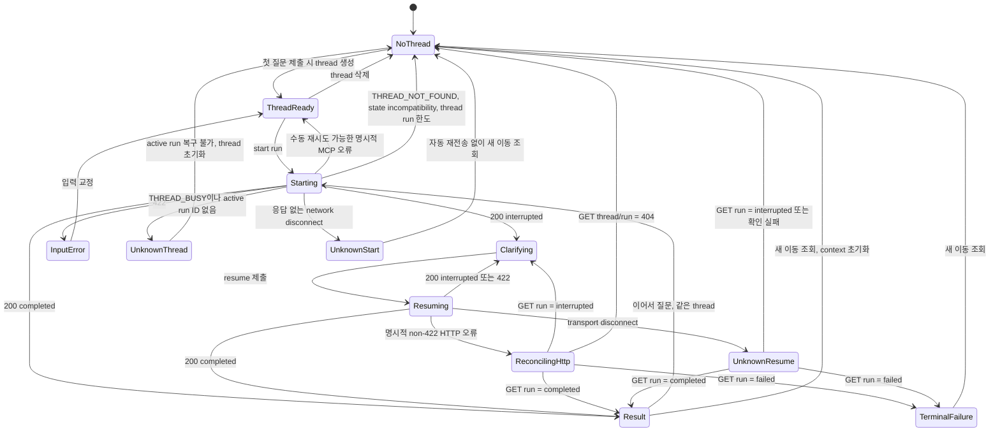

# Barrier-Free Mobility 사용자 흐름

## 1. 범위

이 문서는 동일 저장소 `web/`의 제품 진입, Assistant, 공개 상태와 BFF가 Phase 2C API를
호출하는 순서와 화면 상태 전이를 정의한다. 제품은 trip과 capability-gated station facility를
지원하며 Barrier-Free Mobility MCP만 별도 프로젝트다. facility의 새 진입점은 readiness
전체와 MCP dependency가 ready이고 `facility_question` capability가 있는 환경에서만
활성화한다. alternative 대화와 운영 Console flow는 해당 subgraph·내구 run API가 추가되는
단계에서 확장한다. 공개 제품 route와 보호된 운영 surface의 경계는
[ADR-0008](adr/0008-product-trust-and-operations-surfaces.md)을 따른다.

## 2. 기본 상태 모델



`run_status=failed`인 run에는 resume action을 표시하지 않는다. `이어서 질문`은 같은 thread context를 유지하고 `새 이동 조회`는 새 thread로 trip·mobility context를 초기화한다.

## 2.1 UF-00 제품 진입과 서비스 상태

1. `/`는 thread를 만들거나 Agent run을 시작하지 않는다.
2. 지원 범위는 정적 제품 계약과 public readiness capability를 구분해서 표시한다.
3. readiness 확인 중에는 시설 진입점을 먼저 표시하지 않는다.
4. 사용자가 `이동 조회 시작`을 선택하면 `/assistant`의 질문 전 상태로 이동한다.
5. `/status`는 public allowlist readiness DTO만 사용하고 내부 endpoint, Tool 이름, schema
   fingerprint와 배포 환경 값을 표시하지 않는다.
6. status 요청 실패는 `상태를 확인하지 못했습니다`로 표시하며 마지막 성공 상태를 현재
   상태처럼 추정하지 않는다.
7. status route 장애가 기존 Assistant transcript와 결과를 삭제하거나 숨기지 않는다.

질문 전 Assistant는 정상 readiness card, 빈 결과 panel과 기술 진단 정보를 고정 배치하지
않는다. 현재 지원 범위가 질문 제출에 영향을 줄 때만 inline notice를 표시한다.

## 3. UF-01 명확한 이동 질문

### 선행 조건

- active thread가 없다.
- 사용자가 출발지, 도착지와 계단·에스컬레이터 조건을 명시한다.

### 흐름

1. 화면 진입만으로 thread를 만들지 않는다.
2. 사용자가 첫 질문을 명시적으로 제출하면 `POST /v1/threads`를 lazy 호출한다.
3. 성공하면 `thread_id`를 memory state에 보관하고 `POST /v1/threads/{thread_id}/runs`를 호출한다.
4. 제출 button은 focusable한 상태를 유지하고 `aria-disabled="true"`와 in-flight guard로 중복 submission을 막는다.
5. 응답이 `completed`이면 결과 heading으로 이동할 수 있는 skip link를 제공한다.
6. `user_message`, status와 evidence를 결과 카드에 표시한다.
7. screen reader에는 `조회가 완료되었습니다` 상태만 먼저 알리고 상세 결과는 사용자가 순서대로 읽게 한다.

### 실패 처리

- HTTP 오류이면 결과 카드 대신 오류 panel을 표시한다.
- request ID는 `문제 신고용 정보` disclosure 안에 제공한다.
- 자동으로 같은 요청을 반복하지 않는다.
- 응답 없는 network disconnect는 run 생성 여부를 알 수 없으므로 같은 POST를 자동 재전송하지 않는다.
- 이어진 start가 `THREAD_BUSY`이고 active run ID를 복원할 수 없으면 draft를 보존하고 thread 삭제·재생성을 안내한다.
- thread 생성 뒤 start가 명시적으로 실패하면 같은 thread를 재사용할 수 있지만 새로고침 orphan 정리는 BFF session/TTL 계약 전에는 보장하지 않는다.
- `THREAD_NOT_FOUND`, `AGENT_STATE_INCOMPATIBLE`와 thread별 run capacity는 같은 thread 재시도 action을 제공하지 않는다.

### UF-01A 결과와 공개 근거 확인

1. 결과가 생긴 뒤에만 workspace를 결과 본문과 공개 근거 영역으로 확장한다.
2. 결과 본문은 업무 상태, canonical `user_message`, `AnswerPresentation`과 후속 action 순서로
   표시한다.
3. 공개 근거는 evidence source, 확인 시각, 제한, 미확인 항목과 실패한 source를 값이 있을
   때만 표시한다.
4. 결과 본문과 근거는 DOM에 한 번만 존재하며 CSS로 desktop 2열, mobile 1열을 만든다.
5. `문제 신고용 정보` disclosure에는 현재 request ID만 제공한다.
6. 사용자가 `이어서 질문`을 선택하면 같은 thread context를 유지하고, `새 이동 조회`를
   선택하면 새 thread를 만든 뒤 이전 thread를 best-effort 삭제한다.
7. Tool 이름, graph node, token, 내부 state와 추정 진행 단계는 공개 결과에 추가하지 않는다.

향후 public processing event가 필요하면 owner-scoped allowlist projection이 준비된 뒤 실제
저장 event만 표시한다. internal ops DTO를 Assistant에서 직접 소비하지 않는다.

## 4. UF-02 이동 조건 clarification

1. 질문 결과가 `interrupted + NEEDS_CLARIFICATION`으로 온다.
2. `clarification.prompts`를 하나의 clarification section에 순서대로 표시한다.
3. `answer_request.mode=fields`이면 서버가 제공한 `inputs[]`의 `id`, `prompt_id`, `field`,
   `control`, label, option과 constraints로 native control을 렌더링한다.
4. `control=text`는 명시적 text label, `control=tri_state`는 `yes | no | unknown`,
   `control=single_choice`는 opaque option value의 radio group을 사용하며 초기 선택을 두지 않는다.
5. `answer_request.mode=single_text`이면 여러 prompt에 함께 답할 수 있는 하나의 명시적 textarea를
   제공한다. frontend가 prompt를 파싱해 structured control을 만들지 않는다.
6. 사용자가 제출하면 같은 `run_id`, 현재 `clarification.id`와 tagged v2 answer를 보낸다. field가
   하나여도 `values[]`를 사용한다. 각 item은 `input_id`와 `{kind, value}`만 보내며 response의
   stable field와 control을 반복하지 않고 required input 전체를 한 요청에 포함한다.
7. 누락·중복·추가·kind/control·option 또는 입력 제한 422는 run과 clarification ID를 유지하고
   `input_id`에 오류를 연결하며 모든 draft를 보존한다. 일부 값만 적용된 것으로 표시하지 않는다.
8. `409 STALE_CLARIFICATION`이면 draft를 보존한 채 GET으로 최신 run을 한 번 읽고, 새 form의 field가
   같아도 자동 재제출하지 않는다.
9. 정상 응답이 다시 interrupted이면 이전 form을 read-only로 바꾸고 새 ID의 section을 표시한다.
10. completed이면 clarification controls를 read-only transcript로 바꾸고 결과를 표시한다.
11. 계단·에스컬레이터처럼 안전 판단에 필요한 field에서 `unknown`을 제출하면 graph가 pending
    clarification을 제거한 completed 업무 `FAILED` checkpoint를 남기며 MCP를 호출하지 않는다.
    `unknown`을 `no`로 번역하지 않는다.
12. active clarification 동안 일반 질문 composer는 숨기거나 disabled 사유를 표시하며 새 run 제출을 허용하지 않는다.

호환 기간의 기본 schema v3 response와 legacy answer body는 기존 natural-language 단일 answer를
유지한다. BFF는 `X-Agent-Response-Schema: 4`로 v4를 선택하며 새 Web은 prompt가 아니라 v2
`answer_request`만 따른다.

## 5. UF-03 모호한 역 후보 선택

1. v4 `answer_request.mode=fields`, `control=single_choice`이면 radio group을 렌더링한다.
2. 연결된 prompt, input과 options가 non-empty가 아니면 contract 오류로 처리한다.
3. option의 `label`을 사용자에게 표시하고 현재 clarification에 묶인 opaque `value`를
   `{input_id, value: {kind: choice, value}}`로 보낸다.
4. 초기 선택은 없다.
5. 사용자가 radio를 선택해도 즉시 요청하지 않는다.
6. `선택한 역으로 계속`을 누르면 resume한다.
7. application validation을 통과한 token은 graph station node가 현재 candidate order에 직접
   매핑한다. 자연어 matcher를 거치지 않는다.
8. 잘못된 후보로 다시 interrupted가 오면 기존 선택을 해제하고 API message를 표시한다.

호환 기간의 v3 projection은 기존 `control=choice`, label과 natural-language option value를
유지한다. v4 option은 raw MCP `station_id` 또는 candidate 원본을 포함하지 않는다.

예시:

```text
어느 시청역인가요?

( ) 시청역 · 1호선
( ) 시청역 · 2호선

[선택한 역으로 계속]
```

## 5.1 UF-03A 역 시설 조회

1. BFF가 `readiness.status=ready`, `mobility_mcp.status=ready`, `facility_question` capability를 함께 확인한다.
2. 세 조건이 모두 참일 때만 엘리베이터·장애인 화장실 조회 예시와 새 진입점을 표시한다. checking·not-ready·fetch-error를 capability 부재로 확정하지 않고 기존 facility 결과는 계속 렌더링한다.
3. 사용자가 `2호선 강남역 엘리베이터 운행 중이야?`처럼 역 시설 질문을 제출한다.
4. completed 응답은 `presentation.kind=facility`와 `context.intent=facility_status`를 제공한다.
5. UI는 top-level 조회 완결성과 유형별 `answer_state`, 개별 시설 `status`를 각각 표시한다.
6. `NOT_CONFIRMED`와 빈 details를 `시설 없음`으로 표현하지 않는다.
7. 같은 thread의 `장애인 화장실도?`는 target provenance가 `previous_context`임을 현재 조건에 표시한다.
8. 역이나 시설 유형이 부족하면 `free_text` clarification을 표시하고 같은 run·현재 clarification ID로 resume한다.
9. facility run에서는 이전 trip origin·destination·mobility를 active context로 표시하지 않는다.

capability가 없는 ready 배포에서는 시설 진입점을 숨긴다. API client가 직접 thread/run 시설 질문을 요청하면 Agent는 Tool을 호출하지 않고 completed business `FAILED`와 명시적인 지원 한계를 반환한다. `환승역 화장실은?`은 structured transfer station이 없으므로 route summary를 파싱하지 않고 구체적인 역 이름을 다시 물어야 한다.

## 6. UF-04 MCP 후속 clarification

MCP의 정상 결과가 추가 질문을 요구하면 run은 `interrupted`로 유지된다.

1. API의 `clarification.prompts`와 `user_message`를 그대로 표시한다.
2. 현재 MCP 후속 질문은 v4 `answer_request.mode=single_text`로 제공한다. v3 projection은 기존
   `control=free_text`, `answer_mode=single_text`를 유지한다.
3. prompt의 `fields`가 `other`이거나 자연어에서 보조 분류된 값이어도 frontend가 질문을 해석해
   다른 control로 바꾸지 않는다.
4. `available_partial_info`나 evidence가 있으면 `현재까지 확인된 정보` section에 함께 표시한다.
5. 질문 문자열 동일성으로 반복 여부를 판별하지 않고 자유 입력 도움말을 항상 동일하게 제공한다.
6. clarification cycle budget을 넘은 429는 terminal 오류로 표시하고 새 이동 조회 action을 제공한다.

frontend가 질문의 극성을 추론해 `네`를 boolean field로 직접 변환하지 않는다. `single_text`
value와 현재 clarification ID를 tagged resume body에 넣는다.

## 7. UF-05 무관한 후속 입력

완료된 이동 조회 뒤 `고마워`처럼 새 이동 요청이 아닌 입력을 제출할 수 있다.

1. 새 run이 `UNKNOWN + NEEDS_CLARIFICATION`이면 지원 가능한 질문 예시를 표시한다.
2. 이전 경로를 다시 실행한 것처럼 loading이나 결과를 재사용하지 않는다.
3. 사용자가 `okay`처럼 다시 무관한 답을 보내면 clarification을 유지한다.
4. 새 출발지·도착지 또는 이동 조건을 입력하면 해당 요청으로 진행한다.

## 8. UF-06 resume 중 실행 오류

1. 422는 입력을 보존하고 기존 clarification을 계속한다.
2. 명시적인 non-422 HTTP 오류면 같은 resume을 자동 재전송하지 않고 `GET /v1/runs/{run_id}`로 현재 상태를 조정한다. `completed`이면 기존 결과, `failed`이면 terminal failure, `interrupted`이면 현재 clarification을 표시한다.
3. transport disconnect에서는 즉시 GET한 `interrupted`가 이전 checkpoint일 수 있으므로 재개 가능 증거로 사용하지 않는다.
4. transport disconnect 뒤 GET이 `completed` 또는 `failed`이면 해당 terminal 상태만 반영한다.
5. GET이 `interrupted`이거나 조회도 실패하면 `실행 상태를 확인할 수 없습니다`로 표시하고 같은 run 입력을 비활성화한다.
6. `같은 run으로 다시 시도` 버튼을 제공하지 않는다.
7. 기본 action은 새 thread를 만드는 `조건을 초기화하고 새 이동 조회`다.
8. 직전 입력을 composer draft로 복사할 수 있지만 자동 제출하지 않는다.
9. 같은 thread의 재시도는 이전 context를 사용한다는 명시적 설명, interrupt version과 `ConversationContextView`가 제공된 뒤에만 활성화한다.
10. 새 thread 전환 뒤 이전 thread를 best-effort 삭제한다. 현재는 BFF server session과 TTL cleanup이 없으므로 refresh 이후 cleanup을 보장하지 않으며, Phase 4+에서 실패 ID를 server-side cleanup 대상으로 유지한다.

## 9. UF-07 thread 삭제

1. `대화 삭제` action은 danger가 아닌 neutral destructive style로 제공한다.
2. 현재 대화와 이동 조건이 함께 삭제된다는 설명을 표시한다.
3. 확인 후 `DELETE /v1/threads/{thread_id}`를 호출한다.
4. 204이면 local transcript와 identifiers를 제거한다.
5. focus를 새 조회 heading으로 이동한다.
6. 실패하면 local data를 먼저 지우지 않는다.

## 10. Phase 2C loading 계약

현재 run API는 동기 응답이고 SSE event를 제공하지 않는다.

- 허용: `이동 정보를 확인하고 있습니다` indeterminate status
- 금지: 실제 event가 없는 node별 진행률, 퍼센트와 Tool 이름
- timeout 전환: 네트워크 timeout과 API 504를 구분해 표시
- double submit: button과 안내된 `Ctrl/Cmd+Enter` shortcut을 하나의 in-flight guard로 잠근다.
- textarea의 Enter는 줄바꿈이고 `isComposing=true`에서는 shortcut과 submit handler가 요청을 만들지 않는다.

SSE가 구현되면 다음 사용자용 event만 표시한다.

```text
요청 확인 → 정보 조회 → 근거 확인 → 완료
```

Tool arguments, 원본 결과와 내부 reasoning은 event에 포함하지 않는다.

## 11. UF-08 refresh와 식별자 복구

PostgreSQL backend는 알고 있는 thread/run ID의 재시작 내구성을 제공하지만, 아직 thread 목록, transcript와 active run detail 복구 API가 없다.

1. 첫 질문 제출 시 thread를 lazy-create하고 same-tab에서 `thread_id`, `run_id`와 transcript를 memory state에 유지한다.
2. 새로고침 뒤 서버 대화를 복원할 수 있다고 약속하지 않는다.
3. local storage에 이동 조건이나 질문 원문을 장기 보존하지 않는다.
4. 보관한 식별자로 요청했을 때 404가 오면 local session을 폐기하고 새 thread를 만든다.
5. active run ID를 잃은 뒤 `THREAD_BUSY`가 오면 임의 resume을 시도하지 않고 현재 한계를 설명한 뒤 thread 삭제·재생성 action을 제공한다.
6. hosted UI의 정상 refresh 복구는 thread detail, message history와 active run API 이후 활성화한다.
7. BFF server session과 TTL cleanup이 생기기 전에는 unload event에 의존한 thread 삭제를 보장하지 않는다.
8. `새 이동 조회`는 새 thread 생성 성공 뒤 active ID를 전환하고 이전 thread를 best-effort 삭제한다. 현재는 같은 화면에서 삭제 실패를 알리되 refresh 이후 복구를 보장하지 않는다. Phase 4+ server-side cleanup은 실패 ID를 조용히 버리지 않는다.

Assistant의 trip과 capability-gated facility 대화는 모두 thread/run API를 사용한다. stateless `/v1/accessibility/questions`는 one-shot 호환 surface로만 제공하며 context snapshot과 resume이 없다. `API_OWNER_MODE=trusted_header`에서는 이 endpoint도 BFF 내부 owner/token 인증이 필요하고 browser가 Agent에 직접 header를 보내지 않는다. stateless clarification을 사용하는 별도 surface가 있다면 사용자가 전체 질문을 보완해 다시 제출해야 하고, thread 대화와 transcript를 공유하는 것처럼 표현하지 않는다.

## 12. UI 상태 전이 테스트

| ID | 입력·응답 | 기대 UI |
|---|---|---|
| FLOW-00 | `/` 최초 진입 | thread·run 생성 없이 지원 범위와 Assistant 진입 표시 |
| FLOW-00A | `/status` readiness ready | allowlist 상태와 확인 시각만 표시 |
| FLOW-00B | `/status` 조회 실패 | 상태 미확인 표시, 내부 오류·이전 성공 추정 금지 |
| FLOW-00C | 질문 전 `/assistant` | 빈 결과·정상 readiness panel 없이 composer에 집중 |
| FLOW-01 | completed + SUCCESS | 완료 결과와 evidence |
| FLOW-02 | completed + PARTIAL | 부분 확인 label과 limitation 강조 |
| FLOW-02A | completed + FAILED | 업무 판단 실패, terminal graph failure와 다른 결과 UI |
| FLOW-03 | v4 single-choice + options | opaque value radio group과 resume action |
| FLOW-03A | v4 origin·destination fields | 두 text input을 하나의 atomic resume으로 제출 |
| FLOW-03B | v4 stairs·escalator fields | 두 tri-state group, default 선택 없음 |
| FLOW-03C | 안전 field `unknown` | graph terminal checkpoint, MCP 호출 없이 completed 업무 FAILED |
| FLOW-04 | v4 single-text + questions | 자유 입력 clarification, prompt 해석 금지 |
| FLOW-05 | field 누락·중복·추가·kind/control·option 422 | 동일 run·ID와 전체 draft 유지, input별 error |
| FLOW-05A | stale clarification ID 409 | draft 보존, 최신 run GET, 자동 재제출 금지 |
| FLOW-05B | 같은 resume 동시 제출 | 첫 요청만 적용, 후속 요청 stale/not-resumable |
| FLOW-05C | 기본 v3와 BFF-selected v4 | legacy와 structured 계약 동시 검증 |
| FLOW-06 | resume timeout 후 run failed | 새 thread 기반 이동 조회 action 표시 |
| FLOW-07 | 404 thread | 만료 안내와 새 thread action |
| FLOW-08 | 409 busy | active clarification으로 이동 |
| FLOW-09 | 429 capacity | thread 정리·서비스 한도 안내, Retry-After 없으면 시각 추정 금지 |
| FLOW-10 | thread delete 204 | local state 제거와 focus 복귀 |
| FLOW-11 | start network disconnect | 자동 재전송 금지, draft 보존 |
| FLOW-12 | resume 5xx 후 GET run | terminal 여부에 맞춘 action |
| FLOW-12A | resume disconnect 후 GET interrupted | 같은 run resume 잠금, 새 thread 복구 |
| FLOW-12B | resume 409 후 GET completed | 오류 대신 기존 완료 결과 표시 |
| FLOW-13 | v4 input·prompt 연결 또는 option shape 불일치 | contract 오류, 임의 form 생성 금지 |
| FLOW-14 | compositionstart → Enter | 요청 0회, composition 유지 |
| FLOW-15 | compositionend → 명시적 전송 | 요청 1회 |
| FLOW-16 | facility capability 없음 | Tool 호출 없이 명시적 지원 한계 |
| FLOW-16A | readiness not-ready 또는 fetch error | facility capability로 간주하지 않고 기존 결과 유지 |
| FLOW-17 | facility SUCCESS + AVAILABLE | 조회 성공과 이용 가능 상태를 별도 표시 |
| FLOW-18 | facility PARTIAL + AVAILABLE/UNKNOWN | 확인·미확인 유형 모두 표시 |
| FLOW-19 | facility NOT_CONFIRMED + 빈 details | 시설 부재 문구 금지 |
| FLOW-20 | facility missing station → resume | context/ID 유지 후 facility 완료 |
| FLOW-21 | trip 후 facility run | retained trip context 비노출, 과거 run snapshot 불변 |
| FLOW-22 | completed FAILED + presentation | 구조화 참고 정보와 실패 상태를 함께 표시 |
| FLOW-23 | completed FAILED + presentation null | canonical message와 복구 action만 표시 |
| FLOW-24 | 결과 desktop → 320px reflow | 결과 뒤 공개 근거의 단일 DOM·reading order 유지 |
| FLOW-25 | 공개 결과 DTO | Tool·state·prompt·token·추정 timeline 비노출 |

각 flow는 keyboard-only, screen reader announcement, 200% text-only zoom, 320 CSS px 또는 1280px viewport의 400% browser zoom, WCAG text-spacing override와 portrait·landscape orientation에서 함께 검증한다.
